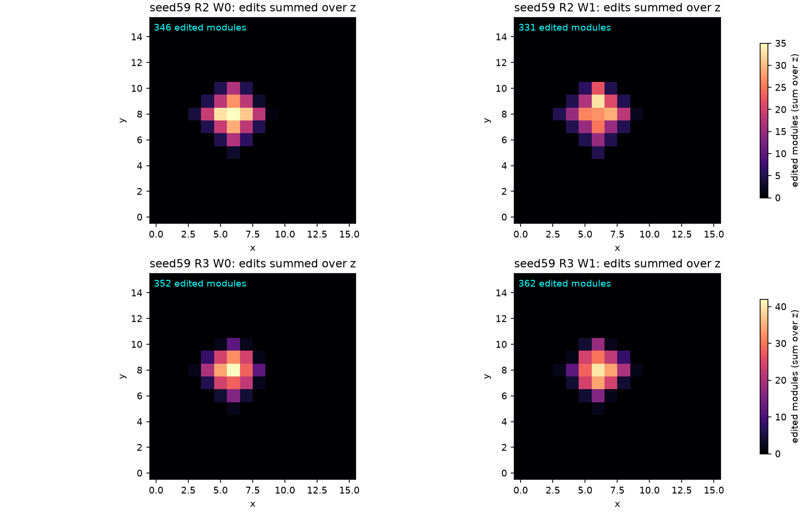
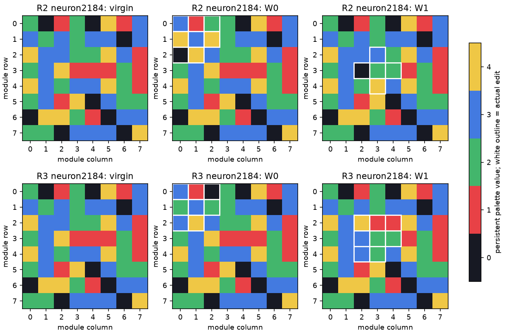
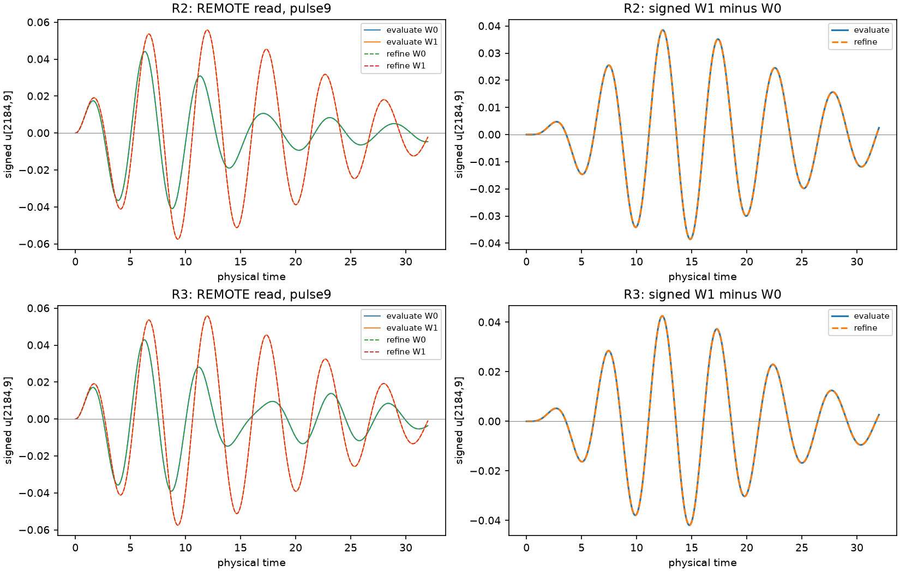
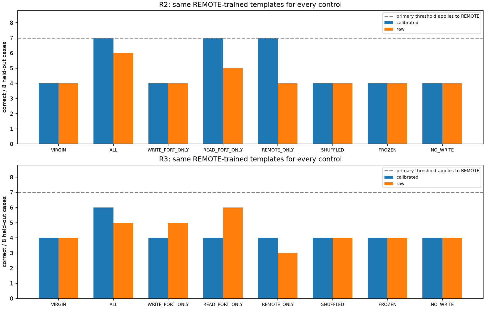
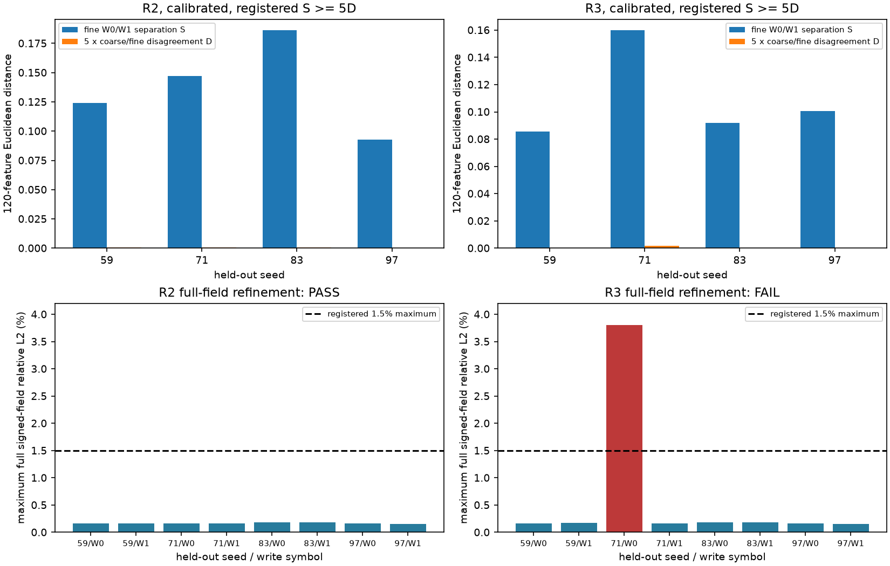

# Experiment 0007: operational control and readout

Registration `2cc0e00` preceded implementation/data; interface/decoder checkpoint `d7f97f0` preceded execution. Baseline `e3255da`. No criteria, feature selection, split or template fit changed after held-out observations. QR7 parser enum correction and per-rule gate scoping are implementation corrections, not new scientific criteria.

This is a finite deterministic test of two externally specified experiences. Calibration and decoder templates are external apparatus. Neither structural change nor successful classification establishes distributed associative retrieval, capacity, resilience, intelligence, or Principle 002 as an experimentally established law.

## Measured verdicts

| Rule | Readout | Training REMOTE | Held-out REMOTE | Fine REMOTE | Ambiguities (held/fine) | Separation/refinement margin | Verdict |
|---|---|---:|---:|---:|---:|---|---|
| R2 | calibrated | 7/8 | 7/8 | 7/8 | 0/0 | PASS | PASS |
| R2 | raw | 5/8 | 4/8 | 4/8 | 0/0 | PASS | FAIL |
| R3 | calibrated | 6/8 | 4/8 | 4/8 | 0/0 | PASS | INDETERMINATE (numerical gate) |
| R3 | raw | 7/8 | 3/8 | 3/8 | 0/0 | PASS | INDETERMINATE (numerical gate) |

The registered R2 operation is **calibration-dependent**: its calibrated decoder passes, while the raw decoder fails. This result relies on an externally retained virgin reference and external templates. It does not show that every possible uncalibrated readout would fail, or establish autonomous associative retrieval.

Primary held-out errors: seed83 W0 predicted 1. All coarse/fine predictions, including these errors, agree.

R2 calibrated is the primary result. R3 and raw readout remain separate secondary results. A software pass cannot override a failed or indeterminate scientific gate. There is no population-level accuracy estimate from these eight paired deterministic cases.

Structural encoding: **PASS** across 24 registered rule/seed/grid pairs; 24/24 pairs have distinct W0/W1 palettes; committed P survives exact transient reset. Repeatability: **PASS**, 39 original/repeat files byte-identical for seed31/R2/W0 WRITE and its two REMOTE reads on this toolchain.

Physical audit: **PASS** for all 496 primary executions. All-tick drift maximum 0.036236% (bound1%). All initial active impulses satisfy E=1 within1e-12; 24 zero exposures remain exactly zero. All frozen exposures and reads retain P. RESET clears u,v,V,H and audit accounts; this does not erase P.

## Execution and provenance

688 logical trajectories =496 actual primary executions +192 explicit virgin-calibration reuses; preselected repeat adds3 actual trajectories (499 total). Training208, held-out208, fine80. No registered condition is omitted. Initial background launch was interrupted before any measurement; the empty ledger is retained separately and is not a scientific failure/retry. Actual runs use fresh folders and never overwrite completed evidence.

Full condition identity is carried by the external ledger, trajectory path and SHA-256 manifest. The signed field body label is the constant `QR7`; it is not a standalone condition identifier. The port/operation/rule/seed/module/dt/tick remain in each QR7 checkpoint.

Coarse writes80, coarse calibration reads16, actual coarse control reads320; fine writes40, fine calibration reads8, fine REMOTE reads32. Reuses apply only to VIRGIN/FROZEN/NO_WRITE reads with exact identical initial physical state. Their observations remain labeled CALIBRATE. FROZEN has an actual write exposure and full history but no commit; NO_WRITE has an actual eight-unit zero exposure and a rule-enabled commit.

WRITE port2182 modules9/27, E1, [0,8], one R2/R3 commit. RESET precedes two independent READ pulses at2183 modules9 then27, E1, [0,32], plasticity off. Sampling sites2184/85/86, modules9/27, signed u/v, times .8/3.2/8/16/32 give120 numeric features. dt.025 primary, .0125 all held-out REMOTE cases plus their exposures/calibrations/controls. No unit-displacement comparisons were collected.

Templates use REMOTE training seeds7,19,31,43 only; held-out59,71,83,97 never enter fitting. Calibration subtracts each seed's separately measured virgin response. No standardization, scaling, pruning or normalization. Two class means, squared Euclidean distance; ties at1e-12 relative tolerance count as incorrect. Raw has its own training means. Labels are compared only after prediction. Numeric feature files contain no label, seed, palette, condition or eligibility data. Source-level API isolation and independent reconstruction support this boundary; this is not a formal information-flow proof.

## Structure and causal controls

The plotted maps are actual seed59 edits summed over z, not activity magnitude. Every neuron owns its palette. Full before/after palettes and edit ledgers are exported; per-neuron edit cap8 and all R3 histogram identities were independently checked. SHUFFLED preserves actual edited count per neuron and edited neuron IDs/distances; R3 additionally preserves each color histogram. R2 does not promise histogram matching; shuffled R3 swaps need not be adjacent. Both ports are restored in REMOTE_ONLY.

| Rule | Control | Calibrated held-out correct | Raw held-out correct | Calibrated ties | Raw ties |
|---|---|---:|---:|---:|---:|
| R2 | VIRGIN | 4/8 | 4/8 | 0 | 0 |
| R2 | ALL | 7/8 | 6/8 | 0 | 0 |
| R2 | WRITE_PORT_ONLY | 4/8 | 4/8 | 0 | 0 |
| R2 | READ_PORT_ONLY | 7/8 | 5/8 | 0 | 0 |
| R2 | REMOTE_ONLY | 7/8 | 4/8 | 0 | 0 |
| R2 | SHUFFLED | 4/8 | 4/8 | 0 | 0 |
| R2 | FROZEN | 4/8 | 4/8 | 0 | 0 |
| R2 | NO_WRITE | 4/8 | 4/8 | 0 | 0 |
| R3 | VIRGIN | 4/8 | 4/8 | 0 | 0 |
| R3 | ALL | 6/8 | 5/8 | 0 | 0 |
| R3 | WRITE_PORT_ONLY | 4/8 | 5/8 | 0 | 0 |
| R3 | READ_PORT_ONLY | 4/8 | 6/8 | 0 | 0 |
| R3 | REMOTE_ONLY | 4/8 | 3/8 | 0 | 0 |
| R3 | SHUFFLED | 4/8 | 4/8 | 0 | 0 |
| R3 | FROZEN | 4/8 | 4/8 | 0 | 0 |
| R3 | NO_WRITE | 4/8 | 4/8 | 0 | 0 |

Validity-qualified remote causal verdict: R2 **PASS** (8/8 pairs); R3 **INDETERMINATE** because seed71/W0 fails the full-field refinement bound. The raw contrast threshold alone is reached in all16 pairs; it does not override that failure.

Remote causal influence reaches the registered1% raw-vector difference in 16/16 selected seed/rule/symbol pairs at both grids. This is a response difference, not an improvement, and is distinct from classification. Control differences are nonadditive; no response percentage is attributed to a specific component. No neuron-level necessity, memory association or resilience test was performed.

## Numerical uncertainty

Signed full-field relative L2 is checked at every nonzero registered read checkpoint with bound1.5%; edit-position Jaccard bound.90; feature relative disagreement bound5%. Per held-out seed/rule, fine W0/W1 feature separation S must exceed1e-10 and5 times the maximum coarse/fine feature disagreement D. Predictions must agree between grids using the original coarse training templates; no finer-grid retraining.

| Rule | Max signed field disagreement | Min edit Jaccard | Exact palettes on fine grid |
|---|---:|---:|---:|
| R2 | 0.186454% | 1.000000 | 8/8 |
| R3 | 3.799194% | 0.995169 | 7/8 |

R3 seed71/W0 has an eligibility-floor crossing at neuron2168, module18: S=1.00059887526727539e-08 coarse versus 9.99868881669826107e-09 fine, around the frozen1e-8 floor. At neuron2168 the coarse run swaps modules10/18 (colors0/2), while fine omits that pair. This explains the recorded palette discrepancy; no counterfactual fixed-palette run was made to attribute the whole-field error solely to this swap. R3's good reduced-feature margin and high edit Jaccard do not rescue its failed1.5% full-field gate. No threshold was changed.

Virgin calibration full-field refinement also passes: maximum 0.186504%. All2631 primary/repeat signed checkpoints are retained. The concatenated repeat120-feature file was additionally compared byte-for-byte.

## Every held-out prediction, including errors and ambiguities

The following primary/secondary REMOTE table includes every held-out case. Full train/control/fine predictions, distances, errors, margins, structural and trajectory tables are in the portable package. `None` denotes an ambiguous incorrect case.

| Rule | Preprocessing | Seed | W expected | Coarse prediction | Fine prediction |
|---|---|---:|---:|---:|---:|
| R2 | calibrated | 59 | 0 | 0 | 0 |
| R2 | calibrated | 59 | 1 | 1 | 1 |
| R2 | calibrated | 71 | 0 | 0 | 0 |
| R2 | calibrated | 71 | 1 | 1 | 1 |
| R2 | calibrated | 83 | 0 | 1 | 1 |
| R2 | calibrated | 83 | 1 | 1 | 1 |
| R2 | calibrated | 97 | 0 | 0 | 0 |
| R2 | calibrated | 97 | 1 | 1 | 1 |
| R2 | raw | 59 | 0 | 1 | 1 |
| R2 | raw | 59 | 1 | 1 | 1 |
| R2 | raw | 71 | 0 | 1 | 1 |
| R2 | raw | 71 | 1 | 1 | 1 |
| R2 | raw | 83 | 0 | 0 | 0 |
| R2 | raw | 83 | 1 | 0 | 0 |
| R2 | raw | 97 | 0 | 0 | 0 |
| R2 | raw | 97 | 1 | 0 | 0 |
| R3 | calibrated | 59 | 0 | 0 | 0 |
| R3 | calibrated | 59 | 1 | 0 | 0 |
| R3 | calibrated | 71 | 0 | 0 | 0 |
| R3 | calibrated | 71 | 1 | 0 | 0 |
| R3 | calibrated | 83 | 0 | 1 | 1 |
| R3 | calibrated | 83 | 1 | 0 | 0 |
| R3 | calibrated | 97 | 0 | 0 | 0 |
| R3 | calibrated | 97 | 1 | 1 | 1 |
| R3 | raw | 59 | 0 | 0 | 0 |
| R3 | raw | 59 | 1 | 0 | 0 |
| R3 | raw | 71 | 0 | 1 | 1 |
| R3 | raw | 71 | 1 | 0 | 0 |
| R3 | raw | 83 | 0 | 0 | 0 |
| R3 | raw | 83 | 1 | 0 | 0 |
| R3 | raw | 97 | 0 | 0 | 0 |
| R3 | raw | 97 | 1 | 0 | 0 |

## Interpretation, verification and limits

Independent Python decoded both checksums of all signed fields, reconstructed all checkpoint energies from tensor neighbor slicing, verified all switch-work partitions, reintegrated V/H at six full-module probe sites, rebuilt eligibility and every actual R2/R3 edit from exported histories, verified causal masks/shuffles, reconstructed all120-component read vectors from full signed checkpoints, independently fit the training means and reproduced every prediction and numerical margin. This is not a second independent full-lattice ODE integration.

The prior 0004 long-window timestep failures and 0005 long-window failure remain unchanged; a bounded QR7 read does not overturn them. Principle 002 is a proposed mechanism, not an experimentally established law. Externally restored virgin P is not demonstrated intrinsic forgetting. Calibration and template storage are not lattice memory. No sequential writes, capacity, interference, damage, GPU dynamics or conventional neural network was introduced.

Reproduce and inspect using the commands in [README](../README.md), the [frozen registration](../EXPERIMENT_0007.md), [schema](EXPERIMENT_0007_SCHEMA.md), and [Operational Lattice Manual](OPERATIONAL_LATTICE_MANUAL.md). Raw data and packages remain ignored under `results/experiment_0007`; package integrity uses SHA-256, not authenticity signatures. Hosted CI, push/remote SHA and local quality checks are delivery evidence separate from these measured scientific verdicts.
