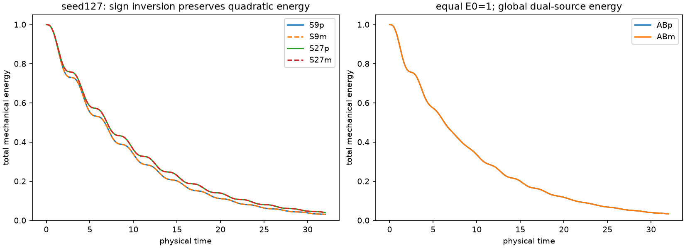
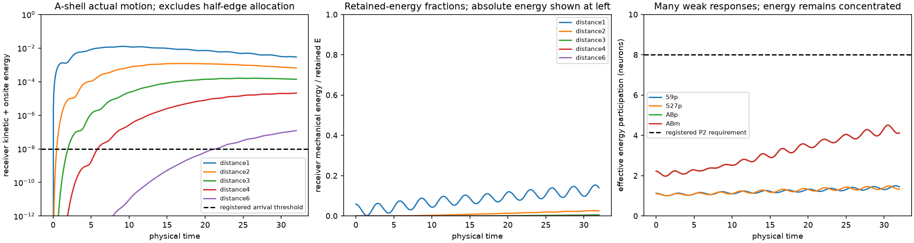
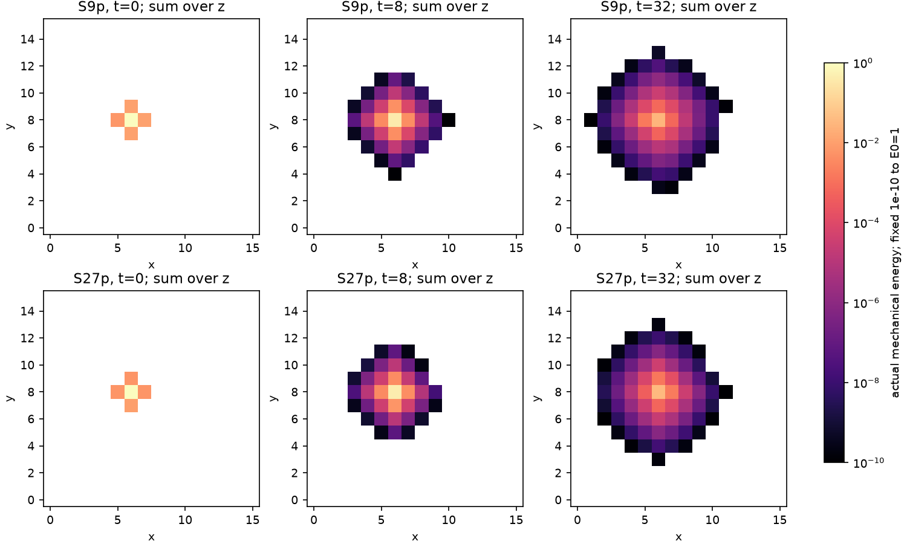
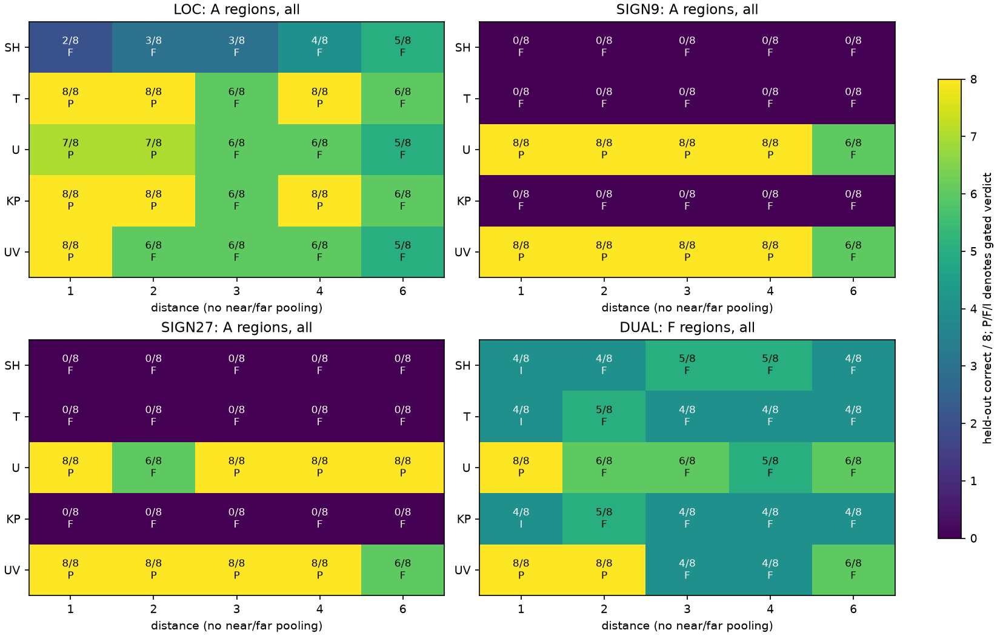
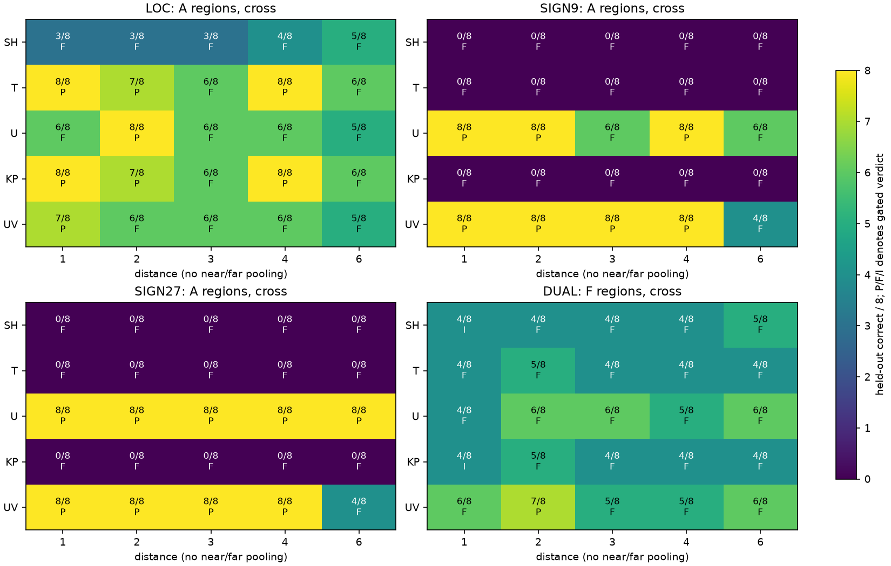
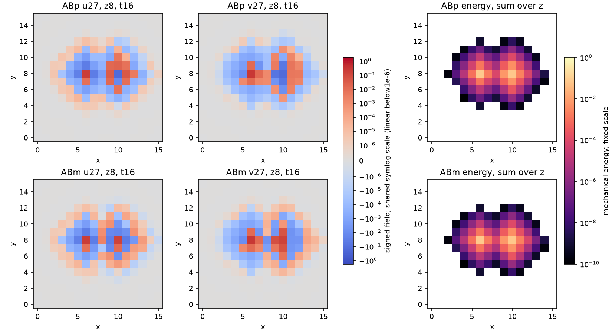
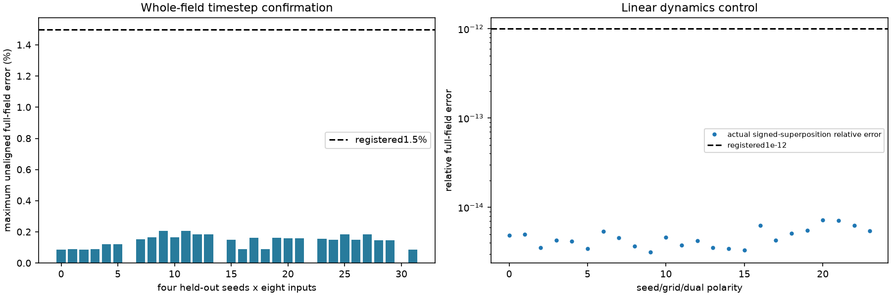

# Experiment 0008: energy distribution and lattice communication

Registration `8e74e54` and implementation/method `325fe77` preceded all new-seed outcomes. Frozen morphology, unchanged QR6 physics, serial CPU f64. Reference seeds101,103,107,109; held-out127,131,137,139. No new-seed threshold fitting, changed signals, feature selection, seed replacement or held-out refitting.

## Separate scientific verdicts

| Question | Registered result | Scope |
|---|---|---|
| P1 | PASS | A-only motion reaches ordered distance shells; arrival/peak refinement |
| P2 | FAIL | energy participation, non-source motion and cross-module motion at one checkpoint |
| P3 | {"A2": "PASS", "A4": "PASS", "A6": "FAIL"} | S9p versus S27p spatial-energy T; primary distal A4, near A2, secondary A6 |
| P4 | PASS | energy sign loss versus signed UV at A2/A4; symmetry independently checked |
| P5 | {"F2": "FAIL", "F4": "FAIL", "F6": "FAIL"} | ABp versus ABm spatial-energy T; primary distal F4, near F2, secondary F6 |
| P6 | PASS | energy, frozen/zero, sign/superposition, repeat and full-field numerical gates |

The positive communication result is specific: S9p versus S27p per-module spatial energy gives8/8 held-out classifications on BOTH grids at A2 and A4. A4 CROSS also gives8/8 after excluding channels9/27; the global-energy trace gives6/8 and fails. A6 spatial energy fails the absolute separation floor (minimum2.74e-12 versus1e-8) and reaches only6/8. Thus energy reaches shell6, but this six-sensor readout does not retain validated discrimination there.

SIGN9/SIGN27 energy-only vectors are identical and yield8 ambiguous held-out cases each; signed UV/all and cross give8/8 at A2/A4. DUAL spatial-energy T gives5/8 at F2 and4/8 at F4, so the registered interaction-discrimination gates fail. Secondary signed UV gives8/8 at F2 but4/8 at F4. Global DUAL energy is INDETERMINATE because its tiny contrast does not clear the numerical-separation margin, despite valid whole-field dynamics. These outcomes concern the fixed readouts; they do not prove every possible distant decoder fails.

These results are not merged into an overall success score. Propagation, redistribution and discrimination are different questions. No associative memory, internal learning, semantics, emergence, resilience or communication capacity is established.

## Execution and definitions

97 actual trajectories:64 primary (.025),32 all-held-out confirmations (.0125),1 preselected seed107/ABm repeat. No reused, sign-synthesized or interpolated trajectories. B27p was added before execution as the independent B-source basis; it is not a classifier label. Each nonzero input has actual E0=1; ZERO has E0=0, v0=0. No continuing drive, palette edits or history accumulation. Complete execution status is exported.

SourceA2182, sourceB2186; four single inputs S9p/S27p/S9m/S27m and dual ABp/ABm. Same actual initial P within each seed and across grids. Model omega/gamma, cardinal module links, Cubic6 links, split update order, damping and boundary semantics are unchanged. Heterogeneous initialization includes the established special module27 policy; these results are conditional on that initializer.

K=.5v^2. Q=onsite plus HALF of every incident edge potential. Actual module mechanical energy is K+Q, not a squared-activity substitute. Motion energy K+onsite excludes edge allocations. At time0 neighboring cells/modules can own half-edge energy with zero local u/v. Arrival therefore uses actual receiver motion energy>=1e-8, while both mechanical and motion crossings are reported. No exact integrated edge-transfer amount is inferred from regional energy change or instantaneous power.

Every tick retains global diagnostics,10 region aggregates and50 fixed signed/energy probes. Full P,u,v,K,Q at0,.8,3.2,8,16,32:582 complete checkpoints. Only the5 nonzero times enter the external readout. Earliest crossings and window peaks use actual sampled ticks, no interpolation; a peak at32 need not be a later global maximum.

A_d is distance from2182; F_d is minimum distance from either potential source. Receivers exclude both source IDs. Full A4 energy separately includes B's initial allocation and is never called arrival fromA. F4 receivers are at least4 hops from BOTH sources. Geometry-only farthest-point sampling fixes6 decoding probes per region, identical for all seeds/inputs/grids. Full shell statistics and actual all-module spatial partitions are retained independently of those six readout probes.

## Energy, transport and spreading

Images use fixed mechanical-energy limits1e-10 to1 (E0), not frame normalization. Log display masks values below its stated display floor only; raw values and scientific thresholds are untouched. The fraction plot explicitly uses currently retained energy; its absolute counterpart prevents relative concentration being mistaken for production.

At initialization nonzero cases have participation 1.102231 to 2.291637, yet all non-source motion-active counts are zero. Allocated outside-injected-module energy ranges from 0.078753 to 0.114270; actual outside-module motion is exactly zero. This initial distinction is measured, not called propagation. Every checkpoint's4096-neuron mechanical/motion array is also exported without a viewer.

P1 individual input/shell decisions: 80/80 PASS. P2 held-out input decisions: 0/24 PASS. All failures and each arrival, peak and physical time are in propagation/spreading/arrivals.csv; the report does not replace failed far results with near ones.

The P2 failure is concentration, not absence of motion: maximum energy participation across all registered held-out checkpoints and both grids is 6.875909, below8. Many non-source neurons and other modules do respond. For seed127/S9p at32,170 non-source neurons pass the1e-8 motion threshold, yet participation is only1.448929; for ABm it is4.128305. The registered P2 joint criterion passes0/24 input/seed pairs and is retained unchanged. P2_components.csv exposes every criterion separately.

## Distinguishability and representation limits

Raw external class means use reference seeds only; no virgin subtraction, whitening, feature scaling, per-frame normalization or adaptive selection. Numeric-only vectors exclude labels, IDs, P, seed and condition metadata. A nearest-mean measurement is not a trained internal neural network. Expected classes are evaluated after prediction. Same held-out templates on both grids.

G is5 total-energy scalars, inherently global/source-inclusive. SH is5 whole-receiver-region energy sums, with larger spatial coverage disclosed. T and U share the same1920 scalar budget (1860 cross): energy per module versus signed displacement at6 probes. KP and UV share3840 observations (3720 cross): kinetic/potential versus signed displacement/velocity. Comparing T to UV doubles scalar observations and is not called budget-matched. Cross excludes BOTH directly stimulated channels9/27, regardless of input. No near/far features are combined. Higher energy-template accuracy than signed-template accuracy is not a universal information ordering: the fixed nearest-mean method responds differently to a quadratic physics-defined feature map and to raw phase-sensitive coordinates.

To pass:>=7/8 correct on each grid, no ties, identical predictions, full-field validity, each feature refinement<=5%, per-seed fine separation above the fixed1e-8 energy /1e-6 signed floor and at least5x coarse/fine disagreement. Invalid physical/feature refinement is INDETERMINATE; below-floor distinguishability FAILS; unresolved separation is INDETERMINATE. Ties count incorrect. See registration for complete priority. Finite paired deterministic cases do not provide a population accuracy or bitrate estimate.

| Pair | Global G train | Global G held-out | Fine | Ties held/fine | Verdict (not distal) |
|---|---:|---:|---:|---:|---|
| LOC | 4/8 | 6/8 | 6/8 | 0/0 | FAIL |
| SIGN9 | 0/8 | 0/8 | 0/8 | 8/8 | FAIL |
| SIGN27 | 0/8 | 0/8 | 0/8 | 8/8 | FAIL |
| DUAL | 4/8 | 4/8 | 4/8 | 0/0 | INDETERMINATE |

Color encodes descriptive accuracy; P/F/I encodes the FULL gated verdict, so correct-but-invalid numerical readouts are not promoted to success. Complete404 model rows,9696 reference/held-out/fine predictions, every error/ambiguity, all distances and per-seed margins are exported in numeric tables. Main selected rows follow; alternative successful rows do not replace a failed primary.

| Pair | Region | Mask | Rep/budget | Train | Held-out | Fine | Ties held/fine | Verdict |
|---|---|---|---|---:|---:|---:|---:|---|
| LOC | A2 | all | SH/5 | 5/8 | 3/8 | 3/8 | 0/0 | FAIL |
| LOC | A2 | all | T/1920 | 8/8 | 8/8 | 8/8 | 0/0 | PASS |
| LOC | A2 | all | U/1920 | 8/8 | 7/8 | 7/8 | 0/0 | PASS |
| LOC | A2 | all | KP/3840 | 8/8 | 8/8 | 8/8 | 0/0 | PASS |
| LOC | A2 | all | UV/3840 | 8/8 | 6/8 | 6/8 | 0/0 | FAIL |
| LOC | A2 | cross | SH/5 | 5/8 | 3/8 | 3/8 | 0/0 | FAIL |
| LOC | A2 | cross | T/1860 | 8/8 | 7/8 | 7/8 | 0/0 | PASS |
| LOC | A2 | cross | U/1860 | 8/8 | 8/8 | 8/8 | 0/0 | PASS |
| LOC | A2 | cross | KP/3720 | 8/8 | 7/8 | 7/8 | 0/0 | PASS |
| LOC | A2 | cross | UV/3720 | 7/8 | 6/8 | 6/8 | 0/0 | FAIL |
| LOC | A4 | all | SH/5 | 5/8 | 4/8 | 4/8 | 0/0 | FAIL |
| LOC | A4 | all | T/1920 | 7/8 | 8/8 | 8/8 | 0/0 | PASS |
| LOC | A4 | all | U/1920 | 7/8 | 6/8 | 6/8 | 0/0 | FAIL |
| LOC | A4 | all | KP/3840 | 8/8 | 8/8 | 8/8 | 0/0 | PASS |
| LOC | A4 | all | UV/3840 | 7/8 | 6/8 | 6/8 | 0/0 | FAIL |
| LOC | A4 | cross | SH/5 | 5/8 | 4/8 | 4/8 | 0/0 | FAIL |
| LOC | A4 | cross | T/1860 | 7/8 | 8/8 | 8/8 | 0/0 | PASS |
| LOC | A4 | cross | U/1860 | 7/8 | 6/8 | 6/8 | 0/0 | FAIL |
| LOC | A4 | cross | KP/3720 | 7/8 | 8/8 | 8/8 | 0/0 | PASS |
| LOC | A4 | cross | UV/3720 | 7/8 | 6/8 | 6/8 | 0/0 | FAIL |
| LOC | A6 | all | SH/5 | 5/8 | 5/8 | 5/8 | 0/0 | FAIL |
| LOC | A6 | all | T/1920 | 7/8 | 6/8 | 6/8 | 0/0 | FAIL |
| LOC | A6 | all | U/1920 | 7/8 | 5/8 | 5/8 | 0/0 | FAIL |
| LOC | A6 | all | KP/3840 | 7/8 | 6/8 | 6/8 | 0/0 | FAIL |
| LOC | A6 | all | UV/3840 | 7/8 | 5/8 | 5/8 | 0/0 | FAIL |
| LOC | A6 | cross | SH/5 | 5/8 | 5/8 | 5/8 | 0/0 | FAIL |
| LOC | A6 | cross | T/1860 | 7/8 | 6/8 | 6/8 | 0/0 | FAIL |
| LOC | A6 | cross | U/1860 | 7/8 | 5/8 | 5/8 | 0/0 | FAIL |
| LOC | A6 | cross | KP/3720 | 7/8 | 6/8 | 6/8 | 0/0 | FAIL |
| LOC | A6 | cross | UV/3720 | 7/8 | 5/8 | 5/8 | 0/0 | FAIL |
| SIGN9 | A2 | all | SH/5 | 0/8 | 0/8 | 0/8 | 8/8 | FAIL |
| SIGN9 | A2 | all | T/1920 | 0/8 | 0/8 | 0/8 | 8/8 | FAIL |
| SIGN9 | A2 | all | U/1920 | 8/8 | 8/8 | 8/8 | 0/0 | PASS |
| SIGN9 | A2 | all | KP/3840 | 0/8 | 0/8 | 0/8 | 8/8 | FAIL |
| SIGN9 | A2 | all | UV/3840 | 8/8 | 8/8 | 8/8 | 0/0 | PASS |
| SIGN9 | A2 | cross | SH/5 | 0/8 | 0/8 | 0/8 | 8/8 | FAIL |
| SIGN9 | A2 | cross | T/1860 | 0/8 | 0/8 | 0/8 | 8/8 | FAIL |
| SIGN9 | A2 | cross | U/1860 | 8/8 | 8/8 | 8/8 | 0/0 | PASS |
| SIGN9 | A2 | cross | KP/3720 | 0/8 | 0/8 | 0/8 | 8/8 | FAIL |
| SIGN9 | A2 | cross | UV/3720 | 8/8 | 8/8 | 8/8 | 0/0 | PASS |
| SIGN9 | A4 | all | SH/5 | 0/8 | 0/8 | 0/8 | 8/8 | FAIL |
| SIGN9 | A4 | all | T/1920 | 0/8 | 0/8 | 0/8 | 8/8 | FAIL |
| SIGN9 | A4 | all | U/1920 | 8/8 | 8/8 | 8/8 | 0/0 | PASS |
| SIGN9 | A4 | all | KP/3840 | 0/8 | 0/8 | 0/8 | 8/8 | FAIL |
| SIGN9 | A4 | all | UV/3840 | 8/8 | 8/8 | 8/8 | 0/0 | PASS |
| SIGN9 | A4 | cross | SH/5 | 0/8 | 0/8 | 0/8 | 8/8 | FAIL |
| SIGN9 | A4 | cross | T/1860 | 0/8 | 0/8 | 0/8 | 8/8 | FAIL |
| SIGN9 | A4 | cross | U/1860 | 8/8 | 8/8 | 8/8 | 0/0 | PASS |
| SIGN9 | A4 | cross | KP/3720 | 0/8 | 0/8 | 0/8 | 8/8 | FAIL |
| SIGN9 | A4 | cross | UV/3720 | 8/8 | 8/8 | 8/8 | 0/0 | PASS |
| SIGN9 | A6 | all | SH/5 | 0/8 | 0/8 | 0/8 | 8/8 | FAIL |
| SIGN9 | A6 | all | T/1920 | 0/8 | 0/8 | 0/8 | 8/8 | FAIL |
| SIGN9 | A6 | all | U/1920 | 8/8 | 6/8 | 6/8 | 0/0 | FAIL |
| SIGN9 | A6 | all | KP/3840 | 0/8 | 0/8 | 0/8 | 8/8 | FAIL |
| SIGN9 | A6 | all | UV/3840 | 8/8 | 6/8 | 6/8 | 0/0 | FAIL |
| SIGN9 | A6 | cross | SH/5 | 0/8 | 0/8 | 0/8 | 8/8 | FAIL |
| SIGN9 | A6 | cross | T/1860 | 0/8 | 0/8 | 0/8 | 8/8 | FAIL |
| SIGN9 | A6 | cross | U/1860 | 8/8 | 6/8 | 6/8 | 0/0 | FAIL |
| SIGN9 | A6 | cross | KP/3720 | 0/8 | 0/8 | 0/8 | 8/8 | FAIL |
| SIGN9 | A6 | cross | UV/3720 | 8/8 | 4/8 | 4/8 | 0/0 | FAIL |
| SIGN27 | A2 | all | SH/5 | 0/8 | 0/8 | 0/8 | 8/8 | FAIL |
| SIGN27 | A2 | all | T/1920 | 0/8 | 0/8 | 0/8 | 8/8 | FAIL |
| SIGN27 | A2 | all | U/1920 | 8/8 | 6/8 | 6/8 | 0/0 | FAIL |
| SIGN27 | A2 | all | KP/3840 | 0/8 | 0/8 | 0/8 | 8/8 | FAIL |
| SIGN27 | A2 | all | UV/3840 | 8/8 | 8/8 | 8/8 | 0/0 | PASS |
| SIGN27 | A2 | cross | SH/5 | 0/8 | 0/8 | 0/8 | 8/8 | FAIL |
| SIGN27 | A2 | cross | T/1860 | 0/8 | 0/8 | 0/8 | 8/8 | FAIL |
| SIGN27 | A2 | cross | U/1860 | 8/8 | 8/8 | 8/8 | 0/0 | PASS |
| SIGN27 | A2 | cross | KP/3720 | 0/8 | 0/8 | 0/8 | 8/8 | FAIL |
| SIGN27 | A2 | cross | UV/3720 | 8/8 | 8/8 | 8/8 | 0/0 | PASS |
| SIGN27 | A4 | all | SH/5 | 0/8 | 0/8 | 0/8 | 8/8 | FAIL |
| SIGN27 | A4 | all | T/1920 | 0/8 | 0/8 | 0/8 | 8/8 | FAIL |
| SIGN27 | A4 | all | U/1920 | 6/8 | 8/8 | 8/8 | 0/0 | PASS |
| SIGN27 | A4 | all | KP/3840 | 0/8 | 0/8 | 0/8 | 8/8 | FAIL |
| SIGN27 | A4 | all | UV/3840 | 8/8 | 8/8 | 8/8 | 0/0 | PASS |
| SIGN27 | A4 | cross | SH/5 | 0/8 | 0/8 | 0/8 | 8/8 | FAIL |
| SIGN27 | A4 | cross | T/1860 | 0/8 | 0/8 | 0/8 | 8/8 | FAIL |
| SIGN27 | A4 | cross | U/1860 | 6/8 | 8/8 | 8/8 | 0/0 | PASS |
| SIGN27 | A4 | cross | KP/3720 | 0/8 | 0/8 | 0/8 | 8/8 | FAIL |
| SIGN27 | A4 | cross | UV/3720 | 8/8 | 8/8 | 8/8 | 0/0 | PASS |
| SIGN27 | A6 | all | SH/5 | 0/8 | 0/8 | 0/8 | 8/8 | FAIL |
| SIGN27 | A6 | all | T/1920 | 0/8 | 0/8 | 0/8 | 8/8 | FAIL |
| SIGN27 | A6 | all | U/1920 | 8/8 | 8/8 | 8/8 | 0/0 | PASS |
| SIGN27 | A6 | all | KP/3840 | 0/8 | 0/8 | 0/8 | 8/8 | FAIL |
| SIGN27 | A6 | all | UV/3840 | 8/8 | 6/8 | 6/8 | 0/0 | FAIL |
| SIGN27 | A6 | cross | SH/5 | 0/8 | 0/8 | 0/8 | 8/8 | FAIL |
| SIGN27 | A6 | cross | T/1860 | 0/8 | 0/8 | 0/8 | 8/8 | FAIL |
| SIGN27 | A6 | cross | U/1860 | 8/8 | 8/8 | 8/8 | 0/0 | PASS |
| SIGN27 | A6 | cross | KP/3720 | 0/8 | 0/8 | 0/8 | 8/8 | FAIL |
| SIGN27 | A6 | cross | UV/3720 | 8/8 | 4/8 | 4/8 | 0/0 | FAIL |
| DUAL | F2 | all | SH/5 | 4/8 | 4/8 | 4/8 | 0/0 | FAIL |
| DUAL | F2 | all | T/1920 | 6/8 | 5/8 | 5/8 | 0/0 | FAIL |
| DUAL | F2 | all | U/1920 | 8/8 | 6/8 | 6/8 | 0/0 | FAIL |
| DUAL | F2 | all | KP/3840 | 6/8 | 5/8 | 5/8 | 0/0 | FAIL |
| DUAL | F2 | all | UV/3840 | 8/8 | 8/8 | 8/8 | 0/0 | PASS |
| DUAL | F2 | cross | SH/5 | 4/8 | 4/8 | 4/8 | 0/0 | FAIL |
| DUAL | F2 | cross | T/1860 | 5/8 | 5/8 | 5/8 | 0/0 | FAIL |
| DUAL | F2 | cross | U/1860 | 8/8 | 6/8 | 6/8 | 0/0 | FAIL |
| DUAL | F2 | cross | KP/3720 | 6/8 | 5/8 | 5/8 | 0/0 | FAIL |
| DUAL | F2 | cross | UV/3720 | 8/8 | 7/8 | 7/8 | 0/0 | PASS |
| DUAL | F4 | all | SH/5 | 5/8 | 5/8 | 5/8 | 0/0 | FAIL |
| DUAL | F4 | all | T/1920 | 6/8 | 4/8 | 4/8 | 0/0 | FAIL |
| DUAL | F4 | all | U/1920 | 8/8 | 5/8 | 5/8 | 0/0 | FAIL |
| DUAL | F4 | all | KP/3840 | 6/8 | 4/8 | 4/8 | 0/0 | FAIL |
| DUAL | F4 | all | UV/3840 | 8/8 | 4/8 | 4/8 | 0/0 | FAIL |
| DUAL | F4 | cross | SH/5 | 5/8 | 4/8 | 4/8 | 0/0 | FAIL |
| DUAL | F4 | cross | T/1860 | 6/8 | 4/8 | 4/8 | 0/0 | FAIL |
| DUAL | F4 | cross | U/1860 | 8/8 | 5/8 | 5/8 | 0/0 | FAIL |
| DUAL | F4 | cross | KP/3720 | 6/8 | 4/8 | 4/8 | 0/0 | FAIL |
| DUAL | F4 | cross | UV/3720 | 8/8 | 5/8 | 5/8 | 0/0 | FAIL |
| DUAL | F6 | all | SH/5 | 4/8 | 4/8 | 4/8 | 0/0 | FAIL |
| DUAL | F6 | all | T/1920 | 5/8 | 4/8 | 4/8 | 0/0 | FAIL |
| DUAL | F6 | all | U/1920 | 8/8 | 6/8 | 6/8 | 0/0 | FAIL |
| DUAL | F6 | all | KP/3840 | 6/8 | 4/8 | 4/8 | 0/0 | FAIL |
| DUAL | F6 | all | UV/3840 | 8/8 | 6/8 | 6/8 | 0/0 | FAIL |
| DUAL | F6 | cross | SH/5 | 4/8 | 5/8 | 5/8 | 0/0 | FAIL |
| DUAL | F6 | cross | T/1860 | 5/8 | 4/8 | 4/8 | 0/0 | FAIL |
| DUAL | F6 | cross | U/1860 | 8/8 | 6/8 | 6/8 | 0/0 | FAIL |
| DUAL | F6 | cross | KP/3720 | 6/8 | 4/8 | 4/8 | 0/0 | FAIL |
| DUAL | F6 | cross | UV/3720 | 8/8 | 6/8 | 6/8 | 0/0 | FAIL |

## Interaction and numerical reliability

Signed superposition uses independently executed A27p and B27p at the same actual P/dt, scaled by measured amplitude ratios alpha,beta for each dual input. It never adds energy trajectories or assumes1/sqrt2. Quadratic energy cross terms create redistribution even though the underlying dynamics are linear. Sign cancellation is not energy destruction; positive local/edge potentials and damping remain in the balance. Signed maps share one fixed symlog scale from-1.8 to1.8 with a linear interval below1e-6; the display transform never enters features or measurements. No observed interference is called emergence.

Maximum all-tick numerical drift 0.03582929% versus1%; full-field refinement max 0.20657201% versus1.5%. Sign inversion checked in 24 seed/grid/module comparisons; exact energy stream byte identity in 24. Matched-amplitude superposition max relative error 7.24933561e-15. Repeat seed107/ABm reproduces 11 case files byte-for-byte on this host/compiler. No cross-platform bit identity is promised.

Full-field numerical failures: none. Energy matching, zero input and frozen palettes were checked independently. A bounded energy trace or an attractive image never rescues failed field refinement.

## Evidence boundaries and reproduction

Python independently reconstructs every module energy partition from actual P/u/v, validates all checkpoint region/probe/global measurements, verifies stream timelines/fractions and source identities, computes arrival/spreading from actual every-tick records, checks full signed controls/refinement, fits only reference observations and regenerates every classifier verdict. Every-tick aggregate values are engine observations validated against full fields at registered checkpoints; this is not a second complete ODE integration or a full-state record at every tick. Source-bound caches bind every input byte.

The authored mechanical units and absolute detection floors are experimental conventions; there is no real sensor-noise or physical-material validation. Failure of a fixed class-mean readout alone does not prove every possible readout fails. By contrast, the explicitly tested even-energy/odd-signed inversion symmetry establishes the prescribed sign ambiguity within this frozen model. Energy arrival, multi-neuron spread and useful remote discrimination remain separate.

Earlier QR4/QR5 timestep failures and QR7 adaptive R3 failure are unchanged. Frozen QR8 findings do not validate plasticity, recall, associations, capacity, interference tolerance, resilience or Principle 002 as an experimentally established law. Principle 002 is a proposed mechanism, not an experimentally established law.

See [registration](../EXPERIMENT_0008.md), [schema](EXPERIMENT_0008_SCHEMA.md) and [README reproduction commands](../README.md). Raw observations, full ledger, source/data manifests, references and viewer-free review/data/full-field archives remain ignored under results/experiment_0008 and are copied to Downloads at delivery. Source checks, local measurements, remote commit and hosted CI are reported separately. No Bevy window, GPU physics, viewer modification or FPS claim was needed.
