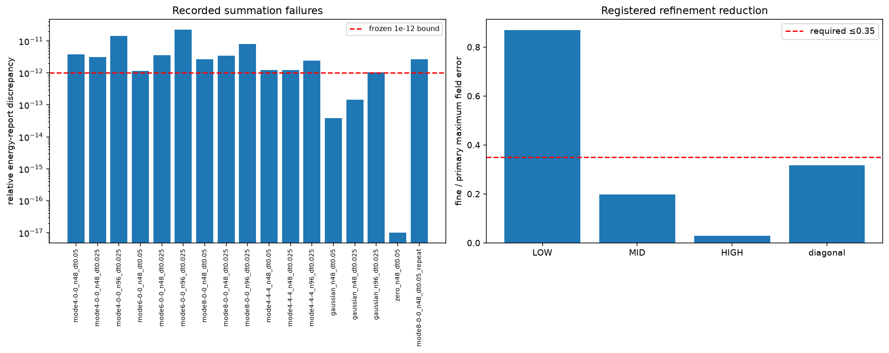
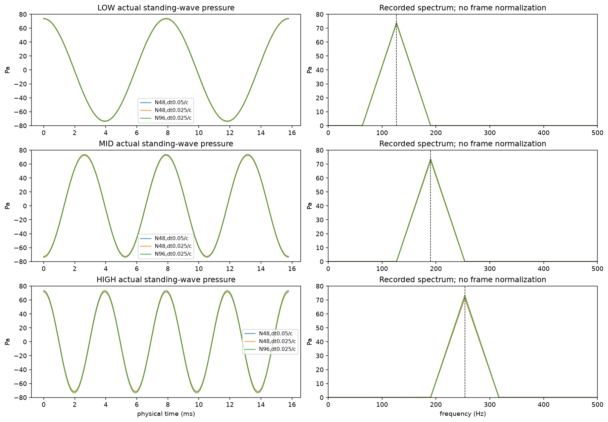
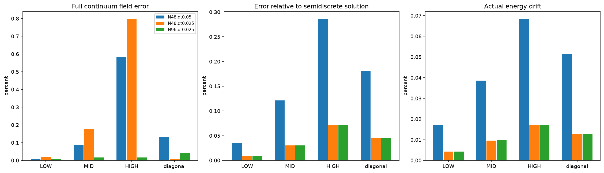
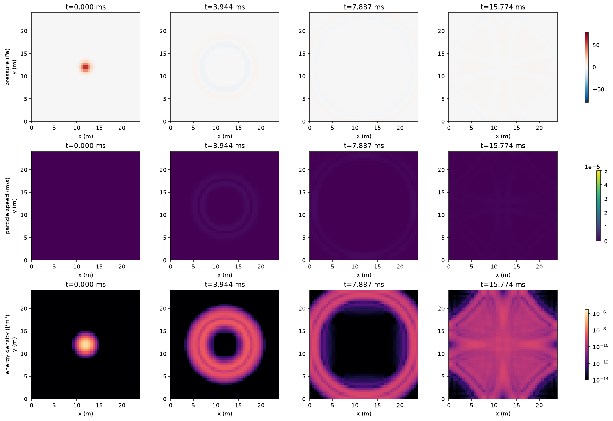
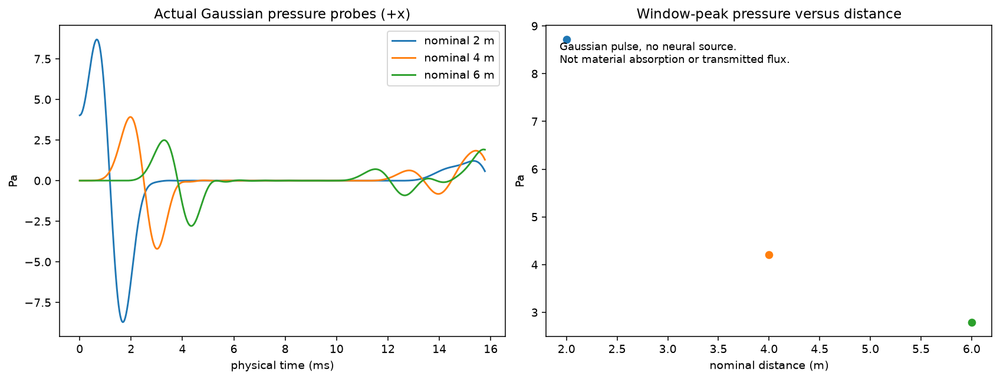

# Experiment 0009: saline acoustic container — standalone gate results

The frozen standalone prerequisite was executed and independently audited. It failed; the registered stopping rule prevents neural coupling or neural confirmation.

## Independent verdicts

| Question | Verdict | Evidence boundary |
|---|---|---|
| S1: Acoustic solver validity | FAIL | Registered standalone gates below |
| S2: Reciprocal coupling | INDETERMINATE | NOT RUN: prerequisite stopping rule |
| S3: Distance-dependent neural transmission | INDETERMINATE | NOT RUN: prerequisite stopping rule |
| S4: Frequency-dependent neural communication | INDETERMINATE | NOT RUN: prerequisite stopping rule |
| S5: Remote S9/S27 discrimination | INDETERMINATE | NOT RUN: prerequisite stopping rule |
| S6: DIRECT/FLUID/HYBRID comparison | INDETERMINATE | NOT RUN: prerequisite stopping rule |
| S7: Immersed-population spatial distribution | INDETERMINATE | NOT RUN: prerequisite stopping rule |
| S8: Numerical reliability | FAIL | Registered standalone gates below |

No overall success score. S1 FAIL means the solver did not satisfy this registration; it does not establish that acoustic communication is impossible. No QR neuron was coupled to the fluid, no acoustic S9/S27 decoder was fitted, and no 0008 improvement is claimed.

## Freeze, execution and independent checks

Registration17ee680 and implementation/methodc07dac9 both preceded execution. No thresholds, numerical grids, initial conditions or analytic formulas were changed after observations. Baseline5fd2794 remains preserved. All17 executions completed: five fixtures on three grids, ZERO and the independent HIGH repeat. Complete q/w at0,6,12,24:68 checkpoints. Every-tick metrics/probes and all failures remain in the raw archive. Full-population253 scientific plus192 work calibrations were conditional; all445 are NOT RUN.

Independent Python reconstructed 580 scalar gates; 31 failed. It checks full continuum and semidiscrete fields, true co-timed energy and its face partition, probe samples, projections, boundary slots, Gaussian reflection/permutation symmetry, zero and repeat. This is analytic field comparison and reconstruction, not a second full fluid integration.

## Physical assumptions and reference properties

T20 C, nominal S35g/kg, reference atmospheric pressure. Computed rho=1024.934178644976kg/m³, c=1521.463200000m/s, adiabatic K=2372569159.096716Pa, mu=0.00107660968648Pa s. These are referenced correlations, not new property measurements. See the [frozen registration](../EXPERIMENT_0009.md) for equations, validity ranges, scale distinctions and primary citations. The model is conservative: viscosity/thermal/chemical absorption are disabled. Its seawater reference does not make it a complete dissipative seawater model.

Engineered mapping: L*=1m, M*=1kg/module, U*=1µm, t*=0.000657262035651s, E*=2.31485026895e-06J. Pressure scale 74.1089897Pa, particle-velocity scale4.75240522e-05m/s. LOW/MID/HIGH=126.788600/190.182900/253.577200Hz; wavelengths12/8/6m. These hertz depend on the engineered mapping. Domain24³m³; rigid reflecting walls; time horizon15.774288856ms. No whale-like range inference.

N48 h.5m dt.05/c; temporal N48 dt.025/c; spatial N96 h.25m dt.025/c. At the shortest carrier wavelength12/24 points and120/240 samples per period. Fourth-order interior staggered gradient, exact negative-transpose divergence, symmetric second-order time split. No numerical clipping or per-frame normalization.

## Recorded gate failures

| Fixture | Gate | Measured | Frozen limit |
|---|---|---:|---:|
| mode4-0-0_n48_dt0.05 | energy_reconstruction_t6 | 3.86114185892e-12 | 1e-12 |
| mode4-0-0_n48_dt0.05 | energy_reconstruction_t24 | 1.1447632965e-12 | 1e-12 |
| mode4-0-0_n48_dt0.025 | energy_reconstruction_t12 | 3.09875581984e-12 | 1e-12 |
| mode4-0-0_n48_dt0.025 | energy_reconstruction_t24 | 3.09493994218e-12 | 1e-12 |
| mode4-0-0_n96_dt0.025 | energy_reconstruction_t6 | 8.57032963116e-12 | 1e-12 |
| mode4-0-0_n96_dt0.025 | energy_reconstruction_t12 | 1.448915062e-11 | 1e-12 |
| mode4-0-0_n96_dt0.025 | energy_reconstruction_t24 | 9.5211410772e-12 | 1e-12 |
| mode6-0-0_n48_dt0.05 | energy_reconstruction_t6 | 1.15629139739e-12 | 1e-12 |
| mode6-0-0_n48_dt0.025 | energy_reconstruction_t12 | 3.52297614922e-12 | 1e-12 |
| mode6-0-0_n48_dt0.025 | energy_reconstruction_t24 | 3.19757389193e-12 | 1e-12 |
| mode6-0-0_n96_dt0.025 | energy_reconstruction_t6 | 1.29622080303e-12 | 1e-12 |
| mode6-0-0_n96_dt0.025 | energy_reconstruction_t12 | 5.33038633808e-12 | 1e-12 |
| mode6-0-0_n96_dt0.025 | energy_reconstruction_t24 | 2.28361856173e-11 | 1e-12 |
| mode8-0-0_n48_dt0.05 | energy_reconstruction_t6 | 2.24281498395e-12 | 1e-12 |
| mode8-0-0_n48_dt0.05 | energy_reconstruction_t24 | 2.69006210186e-12 | 1e-12 |
| mode8-0-0_n48_dt0.025 | energy_reconstruction_t6 | 2.22728831111e-12 | 1e-12 |
| mode8-0-0_n48_dt0.025 | energy_reconstruction_t12 | 3.23704848048e-12 | 1e-12 |
| mode8-0-0_n48_dt0.025 | energy_reconstruction_t24 | 3.42323696504e-12 | 1e-12 |
| mode8-0-0_n96_dt0.025 | energy_reconstruction_t6 | 2.85756603565e-12 | 1e-12 |
| mode8-0-0_n96_dt0.025 | energy_reconstruction_t12 | 8.02610652835e-12 | 1e-12 |
| mode8-0-0_n96_dt0.025 | energy_reconstruction_t24 | 1.01107599658e-12 | 1e-12 |
| mode4-4-4_n48_dt0.05 | energy_reconstruction_t24 | 1.22578664961e-12 | 1e-12 |
| mode4-4-4_n48_dt0.025 | energy_reconstruction_t6 | 1.2271774686e-12 | 1e-12 |
| mode4-4-4_n48_dt0.025 | energy_reconstruction_t24 | 1.00883261692e-12 | 1e-12 |
| mode4-4-4_n96_dt0.025 | energy_reconstruction_t0 | 1.38463726082e-12 | 1e-12 |
| mode4-4-4_n96_dt0.025 | energy_reconstruction_t6 | 1.32309389559e-12 | 1e-12 |
| mode4-4-4_n96_dt0.025 | energy_reconstruction_t24 | 2.40477701366e-12 | 1e-12 |
| gaussian_n96_dt0.025 | energy_reconstruction_t12 | 1.05982033008e-12 | 1e-12 |
| mode8-0-0_n48_dt0.05_repeat | energy_reconstruction_t6 | 2.24281498395e-12 | 1e-12 |
| mode8-0-0_n48_dt0.05_repeat | energy_reconstruction_t24 | 2.69006210186e-12 | 1e-12 |
| mode4-0-0 | spatial_error_reduction | 0.869709162085 | 0.35 |



## Post-outcome causal diagnosis — original failures retained

The worst energy-report disagreement is 2.28361856173e-11 relative. For mode6-0-0_n96_dt0.025 at t=24, recorded energy=3455.999999930910690; repeating ordinary serial summation reproduces that value exactly. Accurate math.fsum gives 3456.000000009832092, while NumPy pairwise gives 3456.000000009832547 (agreement 1.32e-16 relative). This identifies accumulated summation roundoff in the reported total. It does not remove the failed reconstruction gates or establish an unmeasured coupled energy balance.

The LOW combined space/time refinement ratio is0.869709162085, above0.35. Its primary continuum error0.00832961% becomes0.00724434% on the spatial-fine grid. The primary result benefits from cancellation between spatial and temporal dispersion errors. Time refinement alone raises this continuum error to0.01858750%, while its error against the exact semidiscrete solution falls by about4x. Thus small absolute error does not establish the registered convergence ratio.

An analytic check after seeing the failures predicts all12 modal/grid maximum errors within1e-10 absolute, without another simulation: for semidiscrete frequency omega_h, split frequency=2asin(dt*omega_h/2)/dt; pressure coefficient=cos(omega_split*t), velocity coefficient=sin(omega_split*t)/sqrt(1-(dt*omega_h/2)²). Comparing these with the continuum coefficients reproduces the cancellation and its change on refinement. This diagnostic is post-outcome, not a replacement acceptance criterion. The source analysis/diagnose_experiment_0009.py and all numerical values are packaged.

## Actual waveforms, spectra and numerical errors





These are analytic standing-wave validation inputs, not QR-neuron emissions. The spectra use recorded histories, with fixed Pa amplitudes and theoretical carrier markers. Finite observation length limits frequency resolution. Temporal and spatial errors remain separate; stable bounded dynamics alone do not override a failed convergence gate.

| Fixture | Grid | Maximum continuum field error | Maximum semidiscrete time error | Maximum energy drift |
|---|---|---:|---:|---:|
| mode4-0-0_n48_dt0.05 | recorded | 0.00832961% | 0.03588801% | 0.01713691% |
| mode4-0-0_n48_dt0.025 | recorded | 0.01858750% | 0.00897091% | 0.00428368% |
| mode4-0-0_n96_dt0.025 | recorded | 0.00724434% | 0.00897201% | 0.00428386% |
| mode6-0-0_n48_dt0.05 | recorded | 0.08712523% | 0.12108234% | 0.03855949% |
| mode6-0-0_n48_dt0.025 | recorded | 0.17794529% | 0.03026227% | 0.00963708% |
| mode6-0-0_n96_dt0.025 | recorded | 0.01717824% | 0.03028108% | 0.00963908% |
| mode8-0-0_n48_dt0.05 | recorded | 0.58446244% | 0.28668487% | 0.06853835% |
| mode8-0-0_n48_dt0.025 | recorded | 0.79950986% | 0.07163625% | 0.01712578% |
| mode8-0-0_n96_dt0.025 | recorded | 0.01665922% | 0.07177603% | 0.01713691% |
| mode4-4-4_n48_dt0.05 | recorded | 0.13320664% | 0.18093789% | 0.05142829% |
| mode4-4-4_n48_dt0.025 | recorded | 0.00634652% | 0.04521850% | 0.01285213% |
| mode4-4-4_n96_dt0.025 | recorded | 0.04223154% | 0.04522389% | 0.01285266% |
| gaussian_n48_dt0.05 | recorded | N/A | N/A | 0.13471906% |
| gaussian_n48_dt0.025 | recorded | N/A | N/A | 0.03367621% |
| gaussian_n96_dt0.025 | recorded | N/A | N/A | 0.03372741% |
| zero_n48_dt0.05 | recorded | N/A | N/A | 0.00000000% |
| mode8-0-0_n48_dt0.05_repeat | recorded | 0.58446244% | 0.28668487% | 0.06853835% |

## Actual isotropic-source fields



Actual Gaussian-source z=11.75m slice, fixed scales throughout: pressure±80Pa, particle speed0..5e-5m/s, energy density log1e-14..3e-6J/m³. The velocity image averages incident normal faces onto pressure centres. The energy image uses symmetric half-face kinetic partition, whose integral is independently checked. Full face energy remains authoritative. Initial Gaussian fluid energy is matched to1E*, not to the standing-wave inputs' larger energies.



Nominal probes are centre+2/4/6m; nearest pressure cells use a lowest-index tie. N48 positive-axis actual centre coordinates are13.75/15.75/17.75m with transverse11.75m (the nearest-cell sample is not an interpolated point value). Both source extent and closed walls affect observed pulses. Peak pressure is not intensity, stored energy or an integrated transmission amount. Gaussian tails at initialized cells are not validated distant arrivals. No frequency-dependent seawater attenuation curve or receiver-neuron comparison exists: those stages were gated off, not replaced by these standalone plots.

## Resources, reproduction and preservation

Total observed runner wall time123.621235s. Standalone fields/CSV were retained; no old data were overwritten. The executable hash/compiler/source snapshot are in provenance.json, and the complete raw ledger/events/plan are packaged. The protected baseline manifest checks144 historical files, excluding only the four shared index/export files explicitly allowed to change.

```sh
.venv/bin/python -m pip install -r requirements-analysis.txt -r requirements-plot.txt
cargo build --locked --release --bin experiment_0009
cargo run --locked --release --bin experiment_0009 -- standalone results/my-0009
.venv/bin/python -m analysis.experiment_0009 results/my-0009
.venv/bin/python -m analysis.diagnose_experiment_0009 results/my-0009
.venv/bin/python -m analysis.report_experiment_0009 results/my-0009
```

Use a fresh output root. Full independent verification requires the raw field archive; the compact review retains measured audit tables, source and figures but cannot reconstruct omitted fields. Source archive includes all tracked files, geometry/specification dependencies and test fixtures. No viewer is required. No viewer window or FPS measurement was performed; historical iGPU/spacing settings remain untouched.

Final local tests, archive integrity/extraction, pushed SHA and exact hosted CI evidence are recorded separately in the ignored delivery-status.json after the results commit. Missing receipts mean delivery checks remain pending. Software checks do not convert scientific failures into passes.

## Bounded next step

A new registration would be needed to investigate any failed convergence mechanism, with separately varied time and space resolutions and the original failures retained. This run does not authorize retuning the current gates or executing the conditional neural matrix. Previous QR8 four-hop success, six-hop/participation/dual-energy failures and all earlier numerical failures remain unchanged. Principle 002 is a proposed mechanism, not an experimentally established law.
