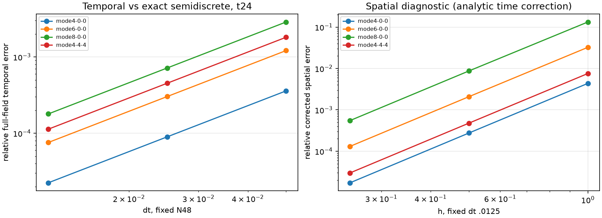
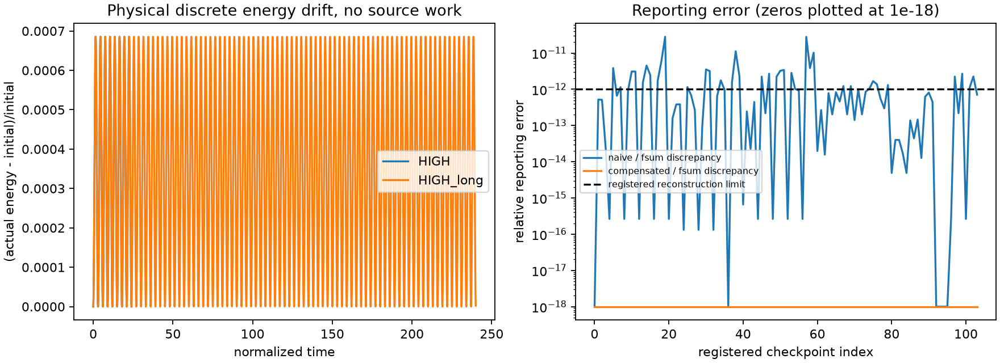
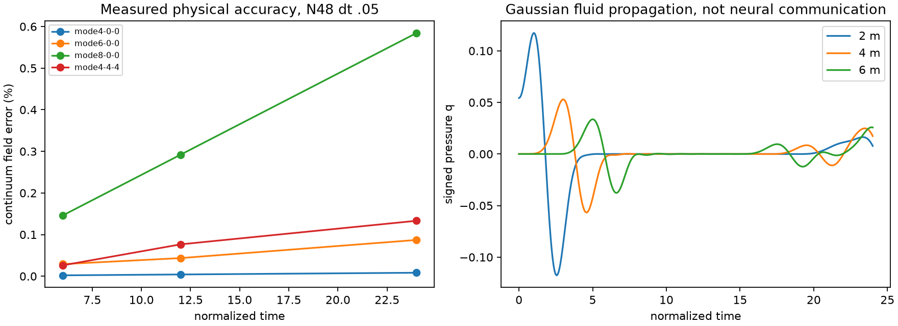
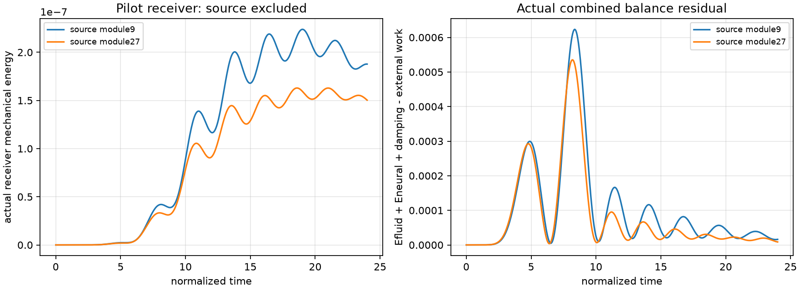
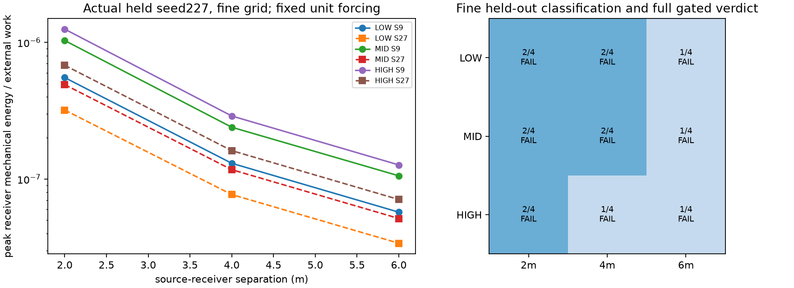
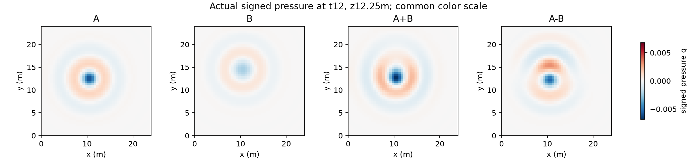

# Experiment 0010: numerical rehabilitation and controlled neural-fluid coupling

Registration `9a3bb58` preceded implementation `1df11d1` and all execution. Historical Experiment 0009 remains FAIL. No overall success score.

## Numerical results

| Category | Verdict |
|---|---|
| A: physical accuracy | PASS |
| B: temporal convergence | PASS |
| C: spatial convergence | PASS |
| D: conservation and accounting | PASS |
| E: reliability | PASS |

Level A: **PASS**. Level B: **PASS**. All26 registered serial executions and104 signed checkpoints audited.

| Mode | Test | Pair | Error ratio | Observed order | Verdict |
|---|---|---|---|---|---|
| mode4-0-0 | B | 0 | 0.2499694799394996 | 2.0001761353112655 | PASS |
| mode4-0-0 | B | 1 | 0.249992369968734 | 2.00004403190501 | PASS |
| mode4-0-0 | C | 0 | 0.06326920230852871 | 3.982352783155163 | PASS |
| mode4-0-0 | C | 1 | 0.06269149865833094 | 3.995586371548404 | PASS |
| mode6-0-0 | B | 0 | 0.2499313469640889 | 2.000396235985901 | PASS |
| mode6-0-0 | B | 1 | 0.24998283503883284 | 2.000099058618125 | PASS |
| mode6-0-0 | C | 0 | 0.06424528937412836 | 3.960265513611838 | PASS |
| mode6-0-0 | C | 1 | 0.06293162246878709 | 3.990071051608139 | PASS |
| mode8-0-0 | B | 0 | 0.2498780425497418 | 2.000703961355376 | PASS |
| mode8-0-0 | B | 1 | 0.2499694989506382 | 2.0001760255887735 | PASS |
| mode8-0-0 | C | 0 | 0.06567555508688708 | 3.9284997007696054 | PASS |
| mode8-0-0 | C | 1 | 0.06326935175508856 | 3.9823493754062382 | PASS |
| mode4-4-4 | B | 0 | 0.24991169799407076 | 2.0005096614777798 | PASS |
| mode4-4-4 | B | 1 | 0.24997792530896154 | 2.000127393813602 | PASS |
| mode4-4-4 | C | 0 | 0.06326930193877767 | 3.9823505113396878 | PASS |
| mode4-4-4 | C | 1 | 0.0626914990600798 | 3.995586362303114 | PASS |

Maximum compensated/f-sum relative reporting discrepancy: 0; unchanged limit1e-12. Maximum naive discrepancy: 2.82239417023e-11. Reporting improvement is not correction of physical energy drift.

Full gate values, component errors, phase, amplitude, speed, energy residuals, all-tick diagnostics and signed fields remain in the portable package. Spatial correction is an analytical diagnostic only; observations are never corrected. The raw continuum error can cancel between spatial and temporal dispersion.

## Stationary actual-neuron pilot

Pilot implementation `489dc6d` preceded all19 cases. Numerical Level A authorized execution; its receipt is preserved. Two actual independently configured64-module QR neurons, QR6 intrinsic/internal equations and frozen palettes; reciprocal engineered beta=.1 transducers. An isolated homogeneous trajectory matches unmodified QR6 within1e-14 in the software parity test. This is a new isolated-neuron adapter, not a simulated4096-neuron population.

| Question | Pilot verdict |
|---|---|
| C1 | PASS |
| C2 | PASS |
| C3 | PASS |
| C7 | PASS |
| EXTENSION | PASS |

| Module | Refinement | Receiver full-history relative error | Source-work difference |
|---|---|---|---|
| 9 | temporal | 0.0022311572 | 0.0011194953 |
| 9 | spatial | 0.019369932 | 0.0011623318 |
| 27 | temporal | 0.0025023184 | 0.0012074219 |
| 27 | spatial | 0.020425181 | 0.0012649833 |

| Pilot case | External work | Positive source-to-fluid work | Backflow | Peak receiver/work | Max balance residual / positive work |
|---|---|---|---|---|---|
| s211_m9_b0_d2_n48_dt0.05_FLUID | 0.44320461 | 0.0015826759 | 1.6593813e-05 | 5.0495122e-07 | 0.0007009334 |
| s211_m9_b0_d2_n48_dt0.025_FLUID | 0.44370133 | 0.0015853543 | 1.6563038e-05 | 5.056957e-07 | 0.00017521955 |
| s211_m9_b0_d2_n96_dt0.025_FLUID | 0.44372036 | 0.0016161046 | 1.8783305e-05 | 5.2539149e-07 | 0.00017521949 |
| s211_m9_b0_d2_n48_dt0.05_ZERO | 0 | 0 | 0 | 0 | 0 |
| s211_m9_b0_d2_n48_dt0.05_OFF | 0.44277497 | 0 | 0 | 0 | 0.00070108332 |
| s211_m9_b0_d2_n48_dt0.05_FROZEN | 0 | 0 | 0 | 0 | 0 |
| s211_m9_b0_d2_n48_dt0.05_SOURCE_ONLY | 0.44320461 | 0.0015831642 | 1.6585129e-05 | 0 | 0.00070093335 |
| s211_m9_b0_d2_n48_dt0.05_RECEIVER_ONLY | 0.44277497 | 0 | 0 | 0 | 0.00070108332 |
| s211_m9_b0_d2_n48_dt0.05_DIRECT | 0.37319167 | 0 | 0 | 0.013051584 | 0.00071805795 |
| s211_m27_b0_d2_n48_dt0.05_FLUID | 0.2720221 | 0.00099272221 | 9.480939e-06 | 5.9887643e-07 | 0.00076370882 |
| s211_m27_b0_d2_n48_dt0.025_FLUID | 0.27235095 | 0.00099463429 | 9.4368763e-06 | 5.9987149e-07 | 0.00019094841 |
| s211_m27_b0_d2_n96_dt0.025_FLUID | 0.27236664 | 0.0010147752 | 1.0761453e-05 | 6.2499296e-07 | 0.00019094856 |
| s211_m27_b0_d2_n48_dt0.05_ZERO | 0 | 0 | 0 | 0 | 0 |
| s211_m27_b0_d2_n48_dt0.05_OFF | 0.27161406 | 0 | 0 | 0 | 0.0007638482 |
| s211_m27_b0_d2_n48_dt0.05_FROZEN | 0 | 0 | 0 | 0 | 0 |
| s211_m27_b0_d2_n48_dt0.05_SOURCE_ONLY | 0.27202211 | 0.00099294833 | 9.4759063e-06 | 0 | 0.00076370876 |
| s211_m27_b0_d2_n48_dt0.05_RECEIVER_ONLY | 0.27161406 | 0 | 0 | 0 | 0.0007638482 |
| s211_m27_b0_d2_n48_dt0.05_DIRECT | 0.22888031 | 0 | 0 | 0.013129219 | 0.00077524881 |
| s211_m9_b0_d2_n48_dt0.05_REPEAT | 0.44320461 | 0.0015826759 | 1.6593813e-05 | 5.0495122e-07 | 0.0007009334 |

OFF, ZERO, frozen-source, receiver-only and source-only remote histories remain exactly zero where registered. SOURCE_ONLY still emits into fluid, while its receiver transducer is disconnected. DIRECT uses an explicitly artificial matching-module spring and zero fluid. Every pilot case file in the independent S9 repeat matches byte-for-byte, including its physical metadata. No cross-platform bit-identity claim.

At2m the width1.5m tensor-hat supports overlap. The pilot establishes an engineered fluid-mediated causal interaction, not isolated-support propagation delay. No material absorption or long-range acoustic result follows.

## Extended gate verdicts

| Stage | C1 emission | C2 reception | C3 accounting | C7 reliability |
|---|---|---|---|---|
| train | PASS | PASS | PASS | PASS |
| evaluate | PASS | PASS | PASS | PASS |
| interference | INDETERMINATE (NOT RUN) | INDETERMINATE (NOT RUN) | PASS | PASS |

INDETERMINATE for an inapplicable stage question means no corresponding gate was run there; interference is evaluated by C6 below. Full per-case failures remain in each stage's gates.csv and verification.json.

## Held-out stationary communication

Pilot prerequisites passed. Extended engine `1efedac` and decoder `194afd7` preceded their executions. The preserved arithmetic clarification interprets the registration's inconsistent template count as9 decoders/18 class vectors (3 bands x3 distances x2 classes). No feature, acceptance criterion or seed changed.34 new calibration cases plus2 explicit pilot reuses precede the frozen templates; all72 held-out trajectories then execute (36 primary and36 fine), with no refit.8 separate three-neuron interference runs follow.

Total159 actual experiment executions:26 numerical +19 pilot +114 extended, with2 explicit calibration reuses. Full fluid fields:503 checkpoints; full actual neural state:399 checkpoints. All signed arrays, all-tick metrics, kick/exchange work, source/configuration/compiler provenance and complete stage plans/events/ledgers remain outside Git in the data package.

Each classifier sees101 remote times4..24 every.2,64 modules,signed u/v:12928 scalars. Source samples and metadata are excluded. Class means use only seeds211,223; held seeds227,229. Positive unit force is NOT equal work across modules, seeds or bands: observed work and emitted/backflow work remain explicit. This therefore does not establish equal-energy coding or efficient information transmission.

| Band | Separation m | Primary correct/4 | Fine correct/4 | Stable | Max feature grid error | Min class-separation/grid-error | C4 |
|---|---|---|---|---|---|---|---|
| LOW | 2 | 2 | 2 | True | 0.02131229 | 18.130517 | FAIL |
| LOW | 4 | 1 | 2 | False | 0.026580461 | 14.121267 | FAIL |
| LOW | 6 | 1 | 1 | True | 0.027054187 | 13.084334 | FAIL |
| MID | 2 | 2 | 2 | True | 0.022940643 | 19.115267 | FAIL |
| MID | 4 | 1 | 2 | False | 0.02947733 | 14.109443 | FAIL |
| MID | 6 | 1 | 1 | True | 0.030325269 | 12.658553 | FAIL |
| HIGH | 2 | 1 | 2 | False | 0.023885373 | 19.849807 | FAIL |
| HIGH | 4 | 1 | 1 | True | 0.0311836 | 14.106403 | FAIL |
| HIGH | 6 | 1 | 1 | True | 0.032389477 | 12.24012 | FAIL |

Calibration predictions (descriptive training diagnostics, not held-out validation):18/36 correct; all mistakes/ties retained in calibration_predictions.csv.

All72 held-out grid-specific predictions retained: 47 incorrect, 0 tied. Numerically valid incorrect predictions remain FAIL; numerical uncertainty cannot rescue them. Complete predictions and margins are in extended/predictions.csv and uncertainty.csv.

C4 has9 failed decoders. In this execution all nine fail on numerically valid observations. This fixed cross-seed readout failure does not establish that every possible readout lacks information. Within-seed differences are numerically resolved; no post-outcome feature selection, refit or seed substitution was performed.

## Distance, frequency and interference

At4m/6m the source and receiver transducer supports are disjoint. Observed receiver responses there test propagation through actual fluid states, with direct QR graph edges disabled. Arrival uses the registered receiver energy/work floor; actual fields and signed complex pressure spectra are retained. The field is conservative and the neurons damp: loss of local amplitude includes geometry, transducer response, interference and neuronal damping, not simulated seawater material absorption.

C5: measured all3 bands and3 distances. Of36 preregistered paired band comparisons normalized by positive emitted work, 22 exceed5x grid discrepancy with numerical validity; 14 remain INDETERMINATE. Every pair, seed and module is in band_comparisons.csv. LOW/MID/HIGH label finite-envelope forcing carriers, not monochromatic fields; signed spectra retain out-of-band response. No universal LOW-band advantage is inferred. Receiver peak/emitted-work is a local response ratio, not integrated transport efficiency.

C6 **PASS**: signed A/B/AB+/AB- full-fluid and all-neuron superposition maximum relative residual 8.62102628e-15. Both independently executed grids, all registered checkpoints and receiver histories are retained. Signed energy cross terms in interference.csv distinguish redistribution from energy destruction. All three actual neurons and all transducers exist in every arm.

## Answers and limits

1. **Energy reporting corrected:** all104 standalone full-field compensated energies equal independent Python math.fsum at exported f64 precision, with the original1e-12 tolerance. Naive summation still reaches2.8224e-11 error. Actual physical energy drift remains separate (maximum0.134719%); no state correction. Evidence: numerical/observations.csv,gates.csv,summary.csv.

2. **Convergence measured:** temporal observed order2.00004-2.00070; corrected spatial order3.92850-3.99559. Fixed-space/time comparisons and exact split residuals are explicit; raw cancellation-prone continuum errors remain preserved. Evidence: numerical/rates.csv,observations.csv.

3. **Registered exploratory solver accuracy passes:** numerical A,D,E and Level A pass; B,C and standalone Level B also pass. This does not remove coupled-field uncertainty. Maximum primary/fine N>=48 continuum field error0.853239%; excluded coarse N24 rate diagnostics reach13.2470%. Long240 is an energy/reliability result only. Evidence: numerical/verification.json and every gate.

4. **Actual QR emission passes the pilot:** source module activity changes the fluid under the explicit reciprocal law, with external work and source-positive/backflow work recorded separately. Evidence: pilot/summary.csv,ports.csv,kicks.csv,exchange.csv and signed checkpoints.

5. **Actual QR reception is causally attributable in the pilot:** remote receiver state responds with fluid ports active and remains zero under the registered disabled/frozen controls. Kernel overlap limits the2m interpretation; extended4/6m have disjoint supports. Evidence: pilot/gates.csv,history.csv and extended/responses.csv.

6. **Controlled source discrimination:** 0/9 registered band-distance decoders meet the complete held-out and uncertainty gates; the table retains all other verdicts. Evidence: extended/decoders.csv,predictions.csv,uncertainty.csv and frozen templates.json.

7. **Limits:** two/three stationary neurons; finite seed and stimulus set; engineered transducer and physical mapping; closed reflecting conservative fluid; unit amplitude rather than equal supplied work; external fixed calibration; no empirical sensor noise, mobile geometry, full-population scaling, capacity, learning, plasticity or associative-memory validation. Standalone Level B is not automatic validation of arbitrary broadband coupled fields. Principle 002 is a proposed mechanism, not an experimentally established law.

## Evidence and reproduction

Software tests are synthetic invariants/parity checks. Independent audits reconstruct recorded fields, geometry, energy, exact substep work and numerical gates; they are not a second complete coupled PDE integration. Every-tick reduced diagnostics are checked at full-state checkpoints, not advertised as every-tick full-field exports. No viewer, GPU execution, native window or FPS witness.

Install pinned analysis/plot dependencies, extract both portable archives together, and use PORTABLE_README.md. Historical protected hashes remain verified. Execution provenance identifies original executables and source commits; source-freeze snapshots preserve those versions independently of final delivery source. Full plans/events/completion/reuse ledgers separate simulations, explicit reuse and scientific decisions. Local strict checks, pushed SHA and hosted CI are recorded separately in delivery receipts.
