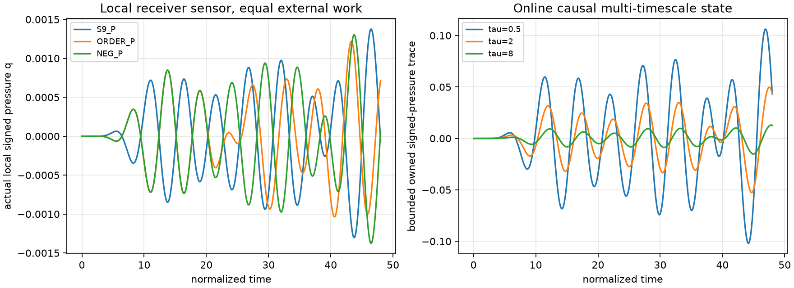
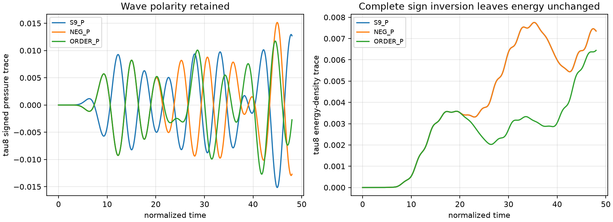
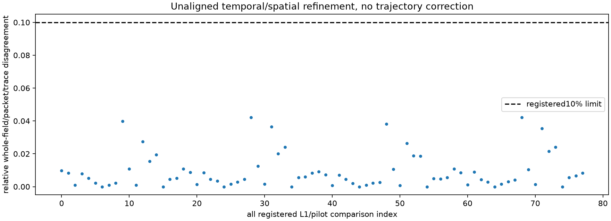
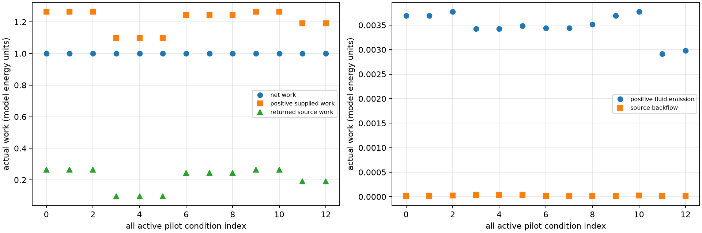
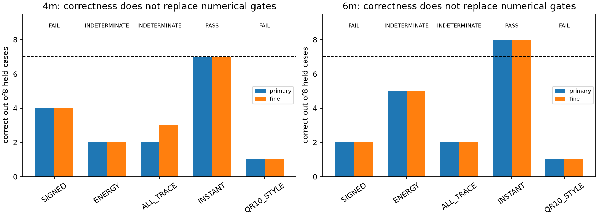
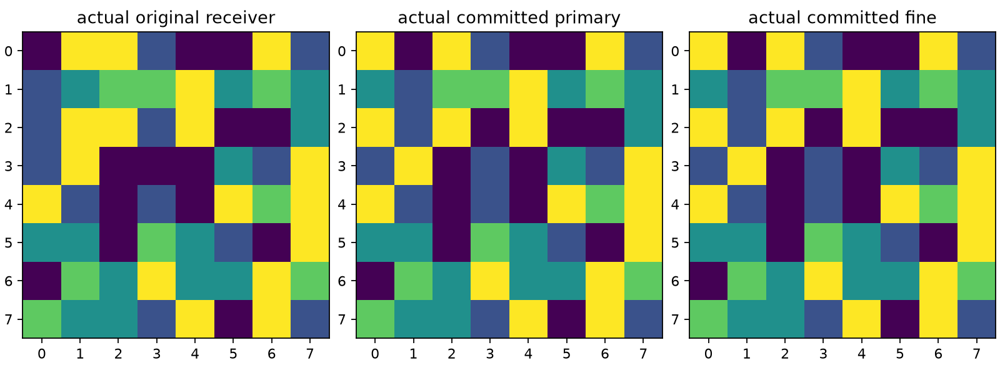
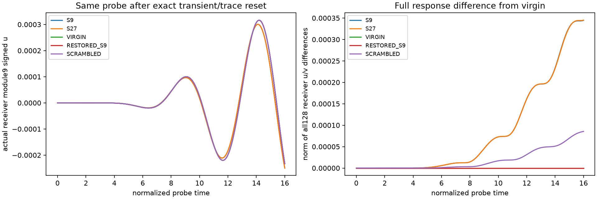

# Experiment 0011: the listening QR neuron

Registration `3ba0680` precedes implementation `bc599b9` and all new outcomes. Earlier experiments remain unchanged; QR10's nine held-out source decoders remain FAIL. Principle 002 is a proposed mechanism, not an experimentally established law. No overall success score.

## Separate scientific verdicts

| Capability | Verdict | Evidence |
|---|---|---|
| L1 causality | PASS | l1/scientific-gates.csv |
| L1 silence | PASS | l1/scientific-gates.csv |
| L1 determinism | PASS | l1/scientific-gates.csv |
| L1 refinement | PASS | l1/scientific-gates.csv |
| L1 polarity | PASS | l1/scientific-gates.csv |
| L1 reference | PASS | l1/scientific-gates.csv |
| L1 reliability | PASS | l1/scientific-gates.csv |
| L2_mechanistic | PASS | pilot/gates.json |
| L2_structure | PASS | pilot/gates.json |
| L3_equal_work | PASS | pilot/gates.json |
| L3 held-out SIGNED, d4m | FAIL | models.csv; predictions.csv |
| L3 held-out SIGNED, d6m | FAIL | models.csv; predictions.csv |
| L4 receiver morphology pilot | PASS | morph_pilot/gates.json |
| L5 post-reset causal response pilot | PASS | retention_pilot/gates.json |
| L5 held-out improvement, d4m | FAIL | retention_improvement.csv |
| L5 held-out improvement, d6m | FAIL | retention_improvement.csv |

## Actual execution and local state

298 actual physical trajectories; 0 registered trajectories NOT RUN; 73 separately counted commitment operations. 877 full signed fluid checkpoints, 877 complete owned-state checkpoints, and 298 every-tick state/trace streams. Case wall time 3108.363193s; raw case bytes 13710751843. Ceilings:3600s and16GB. Full ledger contains every one of the298 possible physical conditions and the actual stopping reason.

Two stationary QR neurons in main experiments; three in the L1 dual-source reference controls. Every instantiated neuron has the same local sensor/trace/morphology implementation, independently owned 8x8 palette,64u/v pairs and405 bounded trace components. Source/receiver designations belong to the apparatus. The neuron receives only its own finite-support local packet, current own state and dt; no source identity, seed, label, prediction, future sample or global-field API.

The adapter preserves QR10 physics. QR6/QR7 full-lattice morphology/reset APIs are incompatible with its isolated state; the new adapter implements explicit local coefficient rebuilding, switch work and reset boundaries. Unit tests cover passive-physics invariance, owned-state reset/serialization, source-work-only calibration and source-excluded readouts. Scientific audits are separate from software tests.

## Energy matching and numerical validity

Every active exposure has a separate frozen-morphology, unit-amplitude physical calibration. Rust reads only SOURCE external net work, sets amplitude=sqrt(1/Wunit), and executes a fresh trajectory. Calibration receiver histories never fit a decoder. Actual net work must equal1 within1e-10; positive/negative source work, fluid emission/backflow and receiver energy remain separate. Equal supplied work is not equal emitted or received energy. OFF controls reuse a declared amplitude and are not asserted work-matched.

Three12-unit pulses begin0,16,32; source modules9/27; MID carrier. Standard signs[+,+,-], ORDER[-,+,+], NEG[-,-,+], SINGLE only the last negative pulse. ORDER has the same unscaled absolute envelope; independent work calibration can change overall gain. SINGLE changes recent amplitude after matching total work. Neither comparison by itself isolates every possible local-magnitude explanation.

Causal trace law z_next=exp(-dt/tau)*z+(1-exp(-dt/tau))*phi, tau(.5,2,8). Phi is explicitly bounded; the physical state is not clipped or normalized.405 components are fixed capacity, not an unlimited history buffer. Sampling is read-only after the complete physical split. Independent Python reconstructs all405 updates at every actual tick, exact kicks/exchange, every local neural ODE step and damping loss, plus full-checkpoint fluid energy/local sensors. This is not a second complete fluid PDE integration.

## Held-out temporary representations

Four training seeds307,311,313,317; four held-out331,337,347,349. Pilot301 and reference211 never fit templates. Ten models were frozen before held execution: five registered representations at each of4m/6m. SIGNED18 is primary; ENERGY3, ALL_TRACE405, INSTANT128 and QR10_STYLE12928 are separate secondary instruments. No best-model replacement, feature tuning, seed substitution, phase alignment or label feedback. Different dimensional budgets are explicit.

| Distance | Representation | Dimension | Primary correct/8 | Fine correct/8 | Stable | Max feature error | Min separation/grid error | Verdict |
|---|---|---|---|---|---|---|---|---|
| 4m | SIGNED | 18 | 4 | 4 | True | 0.03120626 | 11.258416 | FAIL |
| 4m | ENERGY | 3 | 2 | 2 | True | 0.02438306 | 3.2466167 | INDETERMINATE |
| 4m | ALL_TRACE | 405 | 2 | 3 | False | 0.02642936 | 2.287261 | INDETERMINATE |
| 4m | INSTANT | 128 | 7 | 7 | True | 0.028691174 | 8.5215003 | PASS |
| 4m | QR10_STYLE | 12928 | 1 | 1 | True | 0.027375954 | 8.5769777 | FAIL |
| 6m | SIGNED | 18 | 2 | 2 | True | 0.034504216 | 6.8210627 | FAIL |
| 6m | ENERGY | 3 | 5 | 5 | True | 0.032482629 | 3.466618 | INDETERMINATE |
| 6m | ALL_TRACE | 405 | 2 | 2 | True | 0.030428165 | 3.911966 | INDETERMINATE |
| 6m | INSTANT | 128 | 8 | 8 | True | 0.02945073 | 7.0244457 | PASS |
| 6m | QR10_STYLE | 12928 | 1 | 1 | True | 0.02845124 | 7.6269752 | FAIL |

All240 training/held/grid predictions retained, including122 incorrect and0 ties. Variability.csv separates within-seed source differences from between-seed deviations from training means. These are external scientific readouts, never autonomous neuron recognition.

## Actual morphology and retention

The candidate swaps up to four disjoint eligible unequal-color cardinal pairs using only own H/C trace scores. There is no minimum edit count, label, target shape or receiver-only rule. All pre/post arrays, module scores, accepted swaps, independently reconstructed eligibility/ranks, legal colors/histograms and actual Epost-Epre switching work are retained. Switching is externally actuated; reset later removes recorded physical energy. Palette changes alone do not establish useful memory.

| Morphology pilot condition | Source edits | Receiver edits | Receiver switch work |
|---|---|---|---|
| S9_P | 8 | 8 | 2.94697315e-08 |
| S27_P | 8 | 8 | 3.93460304e-08 |
| ORDER_P | 8 | 8 | 9.91280079e-09 |
| NEG_P | 8 | 8 | 2.94697315e-08 |
| SINGLE_P | 8 | 4 | 2.2125869e-08 |
| QUIET_P | 0 | 0 | 0 |
| OFF_P | 8 | 0 | 0 |
| TRACE_OFF_P | 0 | 0 | 0 |
| SCRAMBLED_P | 8 | 8 | 5.77697397e-09 |
| FROZEN_P | 0 | 0 | 0 |
| S9_F | 8 | 8 | 3.06100734e-08 |
| S27_F | 8 | 8 | 4.03417014e-08 |
| ORDER_F | 8 | 8 | 1.02814133e-08 |
| NEG_F | 8 | 8 | 3.06100734e-08 |
| SINGLE_F | 8 | 4 | 2.30665579e-08 |
| QUIET_F | 0 | 0 | 0 |
| OFF_F | 8 | 0 | 0 |
| TRACE_OFF_F | 0 | 0 | 0 |
| SCRAMBLED_F | 8 | 8 | 5.99755479e-09 |
| FROZEN_F | 0 | 0 | 0 |
| REPEAT_P | 8 | 8 | 2.94697315e-08 |

L4 pilot verdict **PASS**. Full failed numerical/structural gates remain in morph_pilot/gates.csv. Receiver edit consistency gates retention; source edits/refinement are independently reported and source morphology is restored before every causal receiver probe.

| Condition | Node | Edited-position P/F Jaccard | Exact palette agreement |
|---|---|---|---|
| S9 | 0 | 1 | True |
| S9 | 1 | 1 | True |
| S27 | 0 | 1 | True |
| S27 | 1 | 1 | True |
| ORDER | 0 | 1 | True |
| ORDER | 1 | 1 | True |

| Primary receiver history | Palette positions different from S9 |
|---|---|
| S27 | 2 |
| ORDER | 4 |
| NEG | 0 |
| SINGLE | 6 |
| SCRAMBLED | 16 |

| Held seed | Distance | History module | Node | P/F palette differences | Edited-position Jaccard |
|---|---|---|---|---|---|
| 331 | 4m | 9 | 0 | 0 | 1 |
| 331 | 4m | 9 | 1 | 0 | 1 |
| 331 | 4m | 27 | 0 | 0 | 1 |
| 331 | 4m | 27 | 1 | 0 | 1 |
| 331 | 6m | 9 | 0 | 0 | 1 |
| 331 | 6m | 9 | 1 | 0 | 1 |
| 331 | 6m | 27 | 0 | 0 | 1 |
| 331 | 6m | 27 | 1 | 0 | 1 |
| 337 | 4m | 9 | 0 | 3 | 0.777777778 |
| 337 | 4m | 9 | 1 | 0 | 1 |
| 337 | 4m | 27 | 0 | 0 | 1 |
| 337 | 4m | 27 | 1 | 0 | 1 |
| 337 | 6m | 9 | 0 | 3 | 0.777777778 |
| 337 | 6m | 9 | 1 | 0 | 1 |
| 337 | 6m | 27 | 0 | 0 | 1 |
| 337 | 6m | 27 | 1 | 0 | 1 |
| 347 | 4m | 9 | 0 | 5 | 0.6 |
| 347 | 4m | 9 | 1 | 0 | 1 |
| 347 | 4m | 27 | 0 | 0 | 1 |
| 347 | 4m | 27 | 1 | 0 | 1 |
| 347 | 6m | 9 | 0 | 5 | 0.6 |
| 347 | 6m | 9 | 1 | 0 | 1 |
| 347 | 6m | 27 | 0 | 0 | 1 |
| 347 | 6m | 27 | 1 | 0 | 1 |
| 349 | 4m | 9 | 0 | 0 | 1 |
| 349 | 4m | 9 | 1 | 0 | 1 |
| 349 | 4m | 27 | 0 | 0 | 1 |
| 349 | 4m | 27 | 1 | 0 | 1 |
| 349 | 6m | 9 | 0 | 0 | 1 |
| 349 | 6m | 9 | 1 | 0 | 1 |
| 349 | 6m | 27 | 0 | 0 | 1 |
| 349 | 6m | 27 | 1 | 0 | 1 |

L5 causal pilot **PASS**. Initial full fields/owned snapshots prove zero u/v,fluid,packets,previous pressure,405 traces,age,commit flags and work/loss/port accounts. Source palette is restored; only declared receiver palette persists. VIRGIN is a fresh body. RESTORED_S9 restores receiver palette at zero state. Probe waveform/amplitude identical across retained histories; actual work variation is separately gated1%. See reset.csv and retention_pilot/gates.csv.

| Retained history | Grid | Full response difference / virgin norm | Absolute difference norm | Source work difference / virgin work |
|---|---|---|---|---|
| S9 | P | 0.478147988 | 0.00246777373 | 1.29407596e-12 |
| S27 | P | 0.477512075 | 0.00246449171 | 1.294298e-12 |
| ORDER | P | 0.47215753 | 0.00243685632 | 1.20303767e-12 |
| NEG | P | 0.478147988 | 0.00246777373 | 1.29407596e-12 |
| SINGLE | P | 0.488055065 | 0.00251890523 | 1.45816692e-12 |
| QUIET | P | 0 | 0 | 0 |
| OFF | P | 0 | 0 | 0 |
| TRACE_OFF | P | 0 | 0 | 0 |
| SCRAMBLED | P | 0.106982164 | 0.000552146574 | 1.80522264e-13 |
| FROZEN | P | 0 | 0 | 0 |
| RESTORED_S9 | P | 0 | 0 | 0 |
| S9 | F | 0.476834601 | 0.00355534041 | 1.10489395e-12 |
| S27 | F | 0.476167772 | 0.00355036845 | 1.10444986e-12 |
| ORDER | F | 0.470817837 | 0.00351047864 | 1.02651221e-12 |
| NEG | F | 0.476834601 | 0.00355534041 | 1.10489395e-12 |
| SINGLE | F | 0.486800224 | 0.00362964538 | 1.24367183e-12 |
| QUIET | F | 0 | 0 | 0 |
| OFF | F | 0 | 0 | 0 |
| TRACE_OFF | F | 0 | 0 | 0 |
| SCRAMBLED | F | 0.10636754 | 0.000793090126 | 1.53654867e-13 |
| FROZEN | F | 0 | 0 | 0 |
| RESTORED_S9 | F | 0 | 0 | 0 |

| Distance | Variant | Primary correct/8 | Fine correct/8 | Ties | Max feature grid error | Min separation / grid error | Verdict |
|---|---|---|---|---|---|---|---|
| 4m | ADAPTED | 0 | 0 | 16 | 0.028034804 | 0 | FAIL |
| 4m | VIRGIN | 0 | 0 | 16 | 0.0280811192 | 0 | FAIL |
| 6m | ADAPTED | 4 | 4 | 0 | 0.0298892821 | 0 | FAIL |
| 6m | VIRGIN | 0 | 0 | 16 | 0.029939146 | 0 | FAIL |
All retention predictions, uncertainties and adapted/virgin contrasts remain in retention_*.csv. Improvement requires a valid adapted pass and higher held correctness on BOTH grids, not a bigger response.

Held-out causal response contrasts: 32/32 PASS (16 retained history conditions, each on both grids). These compare adapted with its own same-seed virgin, not S9 history with S27 history. Full numerical comparisons remain in retention_numerical.csv; zero paired history separation and ties are retained in the failed discrimination result.

## Answers to the eight scientific questions

1. **Local sensing:** L1 component verdicts {'causality': 'PASS', 'silence': 'PASS', 'determinism': 'PASS', 'refinement': 'PASS', 'polarity': 'PASS', 'reference': 'PASS', 'reliability': 'PASS'}. Every instantiated node has identical sensing code, and all measured local fields are checked against its own transducer support.

2. **Causal internal history:** PASS. Independent reconstruction checks every405-component online update from current local samples and own mechanical state, without future/history-file access. Evidence: observations.q11o,audit.json.

3. **Distinguishable structure:** pilot PASS for matched-work reordered input and polarity controls. Cross-seed identity results remain the separate frozen-model table; within-seed separation is not generalization. Evidence: pilot/gates.json,predictions.csv,variability.csv.

4. **Persistent morphology:** PASS under the local trace law and numerical edit-consistency gate. Actual changes, zeros, legality and external switch work are individually recorded; changes alone are not useful memory.

5. **Post-reset causal behavior:** PASS. Only this stage can establish changed response carried by persistent morphology after temporary state removal.

6. **Experience versus alternatives:** paired same-seed virgin/frozen/trace-off/quiet/restored controls address initialization and hidden transients where executed. Equal net work addresses supplied dose; it does not equalize emitted/local absorbed energy. Signed polarity tests separate information from even energy, but the morphology rule is itself polarity-even. Local-magnitude explanations and necessity of repetition are not automatically excluded. No stronger conclusion is inferred from structural change.

7. **Held-out usefulness:** See retained-response and improvement verdicts above. Temporary trace decoding alone cannot answer this. External templates are measuring apparatus, never neuron memory.

8. **Scaling limits:** no4096-neuron dynamics were executed. Owned trace storage would be13,271,040bytes for4096 nodes (arithmetic estimate, not measured scaling). At N96 each radius1.5m kernel has up to1728 cells; two reciprocal ports plus local sensing per node add substantial sampling/split work and overlapping-kernel interactions requiring new numerical validation. Every-tick full owned-state scientific recording would grow to roughly35GB per48-unit fine trajectory. Performance, collective validity, useful retention, energy costs and autonomous repeated commitment remain unresolved.

## Verification and delivery boundaries

Full fields/owned states/trace streams, calibration and source-work associations, reset/commit receipts, all wrong/tied/invalid predictions, complete298-condition ledger, source/compiler/executable provenance and integrity manifests remain outside Git. Small measured figures/report/source are versioned. Original QR10/QR7 failures stay intact. Local strict software checks, independent scientific audits, archive verification, pushed SHA and hosted CI are separate receipts. No viewer, GPU physics, native-window or FPS claim.
