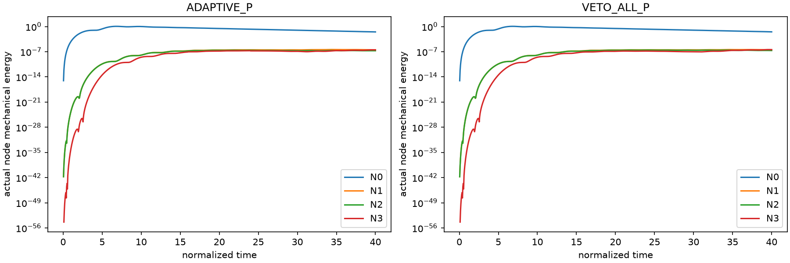
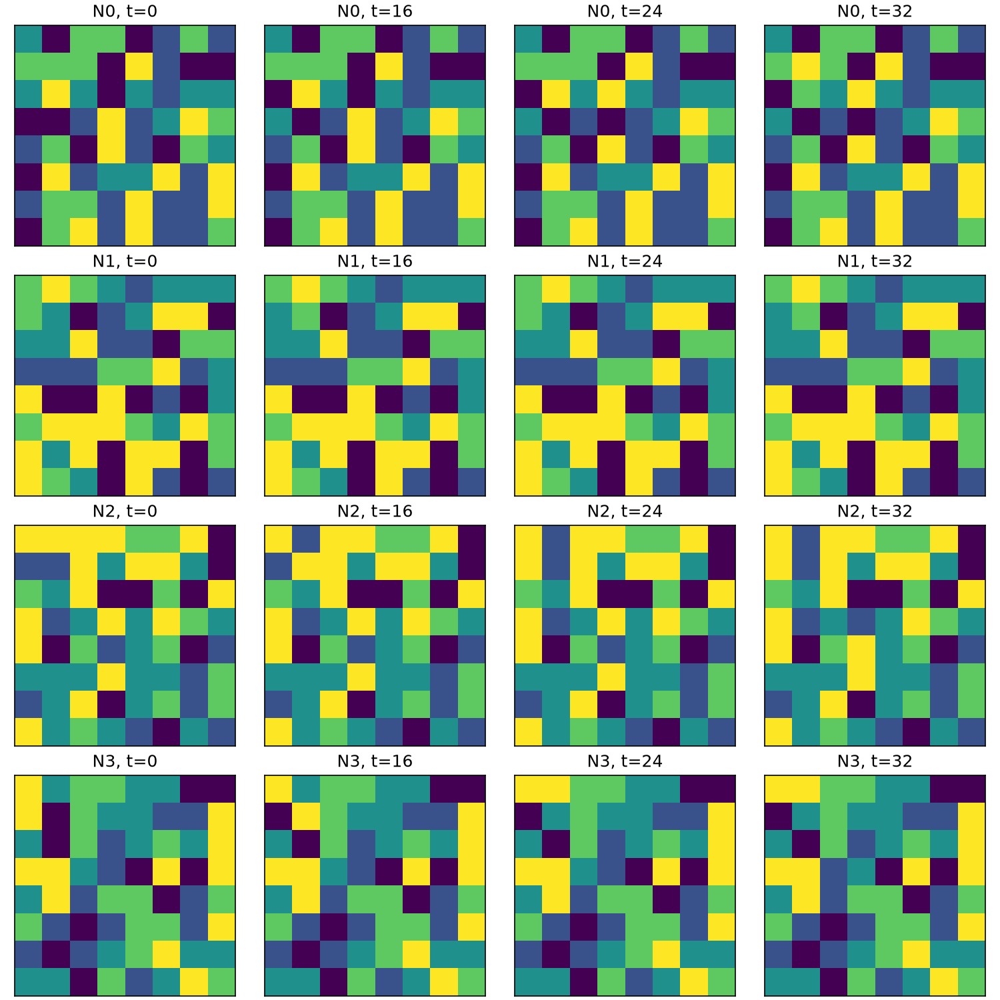
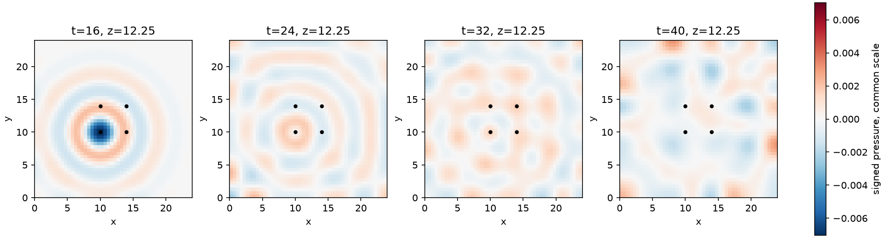
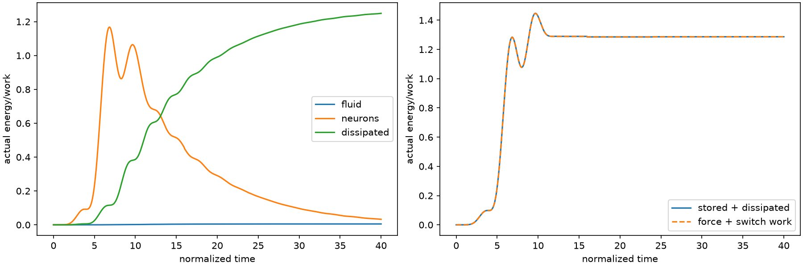
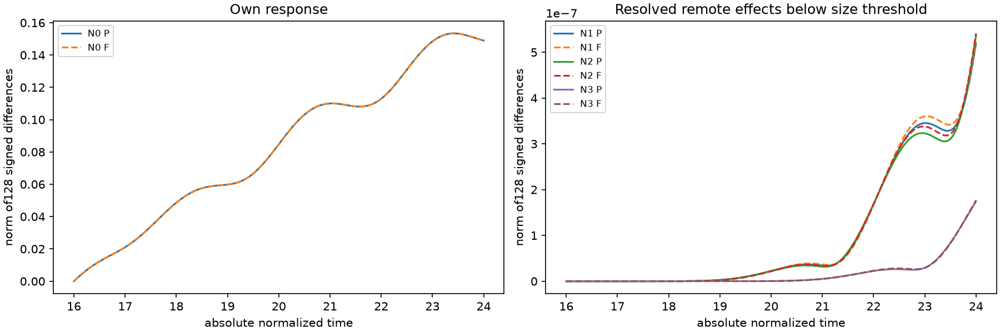
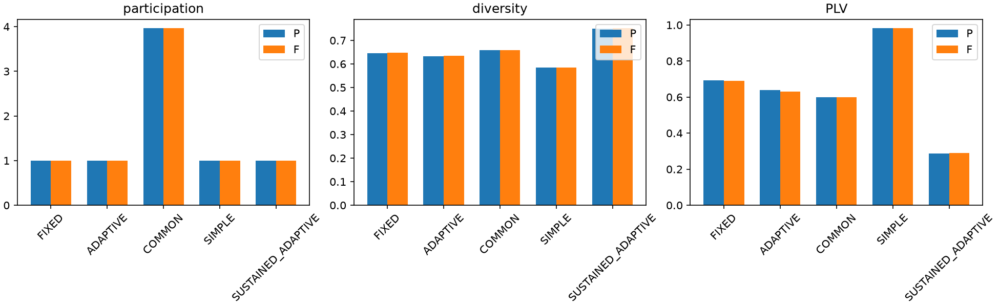
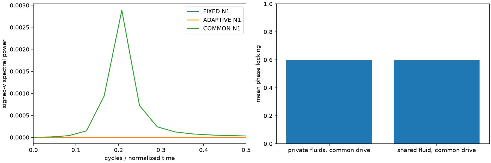
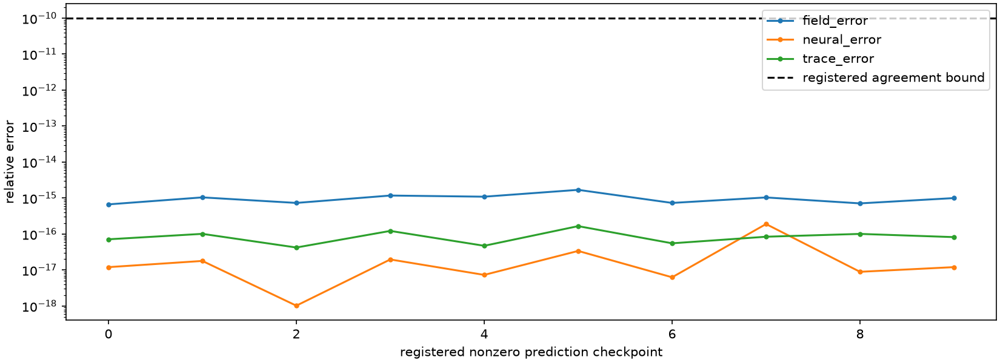

# Experiment 0012: the morphodynamic network

Registration94285ca precedes implementation d548de4 and every QR12 physical outcome. Project branding baseline52e4dba preserves all historical registrations and evidence. Principle002 remains a proposed mechanism, not an experimentally established law. No learning, memory, recognition or intelligence success criterion. No overall success score.

| Separate question | Verdict |
|---|---|
| A extended numerical prerequisite | PASS |
| M1 repeated morphology | PASS |
| M1 refined event/dynamic validity | PASS |
| M1 dynamical consequence | PASS |
| M2_activity_to_morphology | PASS |
| M2_local | PASS |
| M2_remote | FAIL |
| M2_permit_vs_energy_sham | PASS |
| M3_reciprocal_collective | PASS |
| M3_morphological_modulation | INDETERMINATE |
| M3_increased_diversity | INDETERMINATE |
| MATHEMATICAL_VALIDITY | PASS |
| PHYSICAL_AGREEMENT | PASS |
| PREDICTIVE_UTILITY | PASS |
| ENGINEERING_UTILITY | FAIL |

## Coverage and methodological boundaries

80 original actual trajectories (78 valid intended conditions, 2 protocol-invalid controls), plus2 separate diagnostics; 0 original trajectories never started; 615 signed full-field checkpoints; every actual physical tick retains all instantiated nodes,405 traces and local controllers. Actual physical-case wall1082.952121s and raw case bytes10678635624 remain within3600s/16GB. Complete80-condition ledger plus separate diagnostics, exact plans, source/compiler/executable provenance and raw integrity manifests remain outside Git.

Four genuine8x8 QR neurons share one unchanged QR10 fluid state. They use QR11 intrinsic/cardinal equations, mass1, damping and two reciprocal ports each. Source roles are apparatus designations. Positions form the registered4m square; the ALT6m square and private-fluid/simpler-oscillator controls are separately labeled. Internal controller proposals receive only own palette,u/v,packet,traces and clock/history. No direct graph/message bus or decoder supplies a response.

Morphology is explicitly activity-gated at local opportunities16,24,32, max3 one-edge swaps per neuron,8-unit refractory and hysteresis. No minimum changes are forced. This bounded candidate is not autonomous indefinite plasticity. Switching work is an external energetic intervention, not free energy. Read-only computational traces do not include a model of physical storage/computation cost.

## Preserved verifier and observability corrections

[Execution clarifications](EXPERIMENT_0012_EXECUTION_CLARIFICATIONS.md) preserve both original defects and original failed/incorrect audit receipts. Original-QR11 oracle source-only transfer was mislabeled port_net by the observer adapter; the verifier now explicitly interprets that legacy column while still auditing every actual port and total balance. No raw data or trajectory was changed. A later relative-effect verifier mistakenly subtracted a baseline twice; its correction retains the registered0.1% effect threshold and yields M2_remote FAIL. A targeted regression invariant rejects this error. No seed, input, numerical threshold or physical model was tuned. Original failed/incorrect receipts remain in post-outcome-* directories. The unavailable external time wrapper caused no physical case to start; C/D resource measurement used Python getrusage instead.

## M1: ongoing local morphology

All registered pilot counts P/F: [[3, 3, 3, 3], [3, 3, 3, 3]]. Exact accepted-event patterns and all actual palettes agree across P/T/F; numerical gates and every event work/eligibility record remain in b/gates.csv,events.csv,scores.csv,audit.json. Adaptive-veto signed difference norm3.90417191, grid discrepancy0.0163867538.

| Node | Successful events P | Unique observed palettes P |
|---|---|---|
| N0 | 3 | 4 |
| N1 | 3 | 2 |
| N2 | 3 | 4 |
| N3 | 3 | 4 |

Same opportunity times do not demonstrate asynchronous timing. Distinct palettes/patterns and any reversals are observable; event counts alone are not accumulated information or useful adaptation. Quiet/trace-off changes0, unforced OFF changes0, vetoes preserve structure. Own motion can still trigger source events when its fluid coupling is OFF.

Original D NONADAPTIVE_P/F were actually ADAPTIVE because of a substring-selector defect. They are marked PROTOCOL_INVALID: 78 original intended conditions were validly executed, 2 were not. Two separately preregistered post-outcome diagnostics complete the missing control without replacing the original80 or revising their scientific gates. See [diagnostic registration](EXPERIMENT_0012_NONADAPTIVE_DIAGNOSTIC.md), actual metadata and separate ledgers. Total actual physical executions, including diagnostics: 82.

## M2: exact-checkpoint causal branches

Full before-event state at16 is preserved byte-for-byte in each branch; the independent boundary verifier checks every unrelated private state, fluid field, port history and force account. Permit/veto changes only N0 palette and its explicit controller/work consequences. All subsequent opportunities are vetoed. No transient reset occurs.

| Intervention vs veto | Node | Absolute delta norm | Grid error | Relative effect F | Onset | Verdict |
|---|---|---|---|---|---|---|
| PERMIT | N0 | 1.20309782 | 0.00305492925 | 0.134700561 | 16.05 | PASS |
| PERMIT | N1 | 2.21110188e-06 | 1.14621801e-07 | 0.000242903471 | 18.15 | FAIL |
| PERMIT | N2 | 2.15218498e-06 | 1.12617469e-07 | 0.000263801758 | 18.15 | FAIL |
| PERMIT | N3 | 4.85173902e-07 | 1.88297281e-08 | 7.76234786e-05 | 19.4 | FAIL |
| SHAM | N0 | 0.0392216051 | 6.01411791e-05 | 0.00439130727 | 16.0 | PASS |
| SHAM | N1 | 5.98442492e-06 | 2.14258445e-07 | 0.000657426775 | 17.4 | FAIL |
| SHAM | N2 | 5.9601314e-06 | 2.23757677e-07 | 0.000730556692 | 17.4 | FAIL |
| SHAM | N3 | 2.34436652e-06 | 7.8619505e-08 | 0.000375077645 | 18.6 | FAIL |
| EXTERNAL | N0 | 2.08072987 | 0.00474541742 | 0.232961507 | 16.05 | PASS |
| EXTERNAL | N1 | 9.83595152e-05 | 3.90063822e-06 | 0.0108054123 | 17.95 | PASS |
| EXTERNAL | N2 | 9.43507674e-05 | 3.87474567e-06 | 0.0115649438 | 17.95 | PASS |
| EXTERNAL | N3 | 2.53254418e-05 | 9.1357252e-07 | 0.00405184384 | 19.2 | PASS |

Remote permit-veto signals are numerically resolved but below0.1% of their baseline responses: the registered remote gate FAILS. Detectable propagation is not sufficient potency. Isolated permit/veto remote u/v histories agree exactly on both grids, supporting the shared-fluid pathway. The sham matches total energy, not modal distribution; permit/sham differences therefore do not completely isolate coefficient changes from every state-perturbation explanation.

## M3: collective dynamics and controlled regimes

Actual all-node metrics, undefined phase-pair counts, spectra, work/dose and per-condition numerical values remain in collective-verification.json and collective-numerical.csv. Late statistics use the registered16..40 window, sampled at common.05 cadence on both grids; every underlying physical tick remains available. Undefined zero-response phases/diversity are not invented.

| Seed | Morphological modulation | Increased diversity | Changes P/F |
|---|---|---|---|
| 409 | INDETERMINATE | INDETERMINATE | [{'participation': -2.5974500004188883e-06, 'diversity': -0.012808199510808915, 'PLV': -0.05217669909592537, 'decay_ratio': 0.002798635296624989, 'dose_relative_difference': 0.0034614021495536097}, {'participation': -2.9674259132139724e-06, 'diversity': -0.013300075737315176, 'PLV': -0.05953401056583363, 'decay_ratio': 0.004160317278706478, 'dose_relative_difference': 0.000958713639970313}] |
| 419 | FAIL | FAIL | [{'participation': 1.6927099932839695e-06, 'diversity': 0.013542247730347734, 'PLV': -0.020683668975151615, 'decay_ratio': -0.001249187822168013, 'dose_relative_difference': 0.0005034914394215103}, {'participation': 1.7779016439067874e-06, 'diversity': 0.013496080346269035, 'PLV': -0.02768590930329584, 'decay_ratio': -0.001229825115301425, 'dose_relative_difference': 0.0005009277162156622}] |

| Regime/perturbation | Relative effect | Delta / grid uncertainty | Verdict |
|---|---|---|---|
| sustained | 1.23123243 | 1269.8105 | PASS |
| geometry | 0.00171961429 | 41.1648012 | FAIL |
| perturb_fixed | 0.00479898901 | 763.878388 | PASS |
| perturb_adaptive | 0.00482333437 | 718.529704 | INDETERMINATE |

COMMON drives all four bodies with amplitude.5. Four actual private-fluid INDi trajectories provide equivalent common forcing without reciprocal interaction. SOLO0 plus three explicitly analytic zero solutions supplies the single-source independent baseline; those zeros are not counted as runs. SIMPLE is a declared two-scalar-per-body control with identical two port geometries, not a substitute QR neuron or a fitted equal-spectrum model. Greater activity/diversity is not automatically better. Additional structural work can confound an increased-diversity/efficiency claim.

Adaptive seed409 violates the10% whole-history refinement screen (u19.69%,v22.27%,traces22.01%) and has different event/palette patterns. Similar aggregate bars or bounded energy do not repair this failure. Seed419 is numerically valid but does not show the required resolved modulation/diversity increase. Overall adaptive modulation/diversity remain INDETERMINATE, with the separate valid negative result retained.

The original NONADAPTIVE labels are invalid as controls. The separately preregistered corrected diagnostics use the intended lexicographic rule, preserve the original failed/mislabeled observations, and are reported descriptively without changing original gates. Their actual numerical/control data are in diagnostic-nonadaptive-verification.json.

M3 fixed shared-vs-private single-source history effects are0.1235% on P and0.1266% on F. This40-unit interaction-presence test differs from M2's8-unit single-morphology intervention; passing it does not rescue M2's weak remote effect.

Per-node registered perturbation reach/onset and late-to-early RMS ratios are retained in perturbation-effects.csv. These are descriptive responses, not proof of return to an arbitrary equilibrium deadline; adaptive perturbation remains numerically indeterminate.

## M4: composition without a new physical law

[Definitions and proof](EXPERIMENT_0012_COMPOSITION.md) specify typed complete-state partial maps and open node-pair interfaces. Identities/associative words are exact structural laws; they alone are potentially trivial. Shared fluid ownership and port order are explicit. No tensor product of closed private-fluid neurons is asserted.

Independent predictions were frozen before seed427 direct outcomes. Maximum full-field relative prediction error 1.69061879e-15; neural error1.89349261e-16. Full numerical refinement and all errors remain in composition-errors.csv and composition-verification.json. This demonstrates an independently implemented open-operator numerical model, not unique categorical predictive power over ordinary correct modular physics.

Formal verdicts: PASS; physical agreementPASS; predictive testPASS; categorical engineering advantageFAIL. Both typed composition and the conventional physical validator reject the same6faults. The registered engineering-advantage test therefore FAILS. No invented code-saving, runtime or exclusivity advantage is claimed.

## Answers and limits

M1: repeated in-operation local palette evolution is tested separately from numerical validity and consequence. M2: local structural response can produce a resolved remote signal through the fluid, yet the registered remote effect-size gate FAILS; signal detection is not sufficient potency. M3: the control/uncertainty tables above decide the actual finite driven collective results. M4: valid partial-map composition and independent physical prediction do not establish special categorical engineering advantage. No global success score.

Only four genuine neurons were studied. There is no4096-body, mobile geometry, dissipative seawater, hardware QR material or biological learning result. Longer adaptive horizons, finer event-boundary stability, actuator/storage costs, larger populations and a fair speed/accuracy competition with established solvers remain missing. Historical QR10/QR11 and older failures stay frozen.

## Delivery evidence

Local format/lint/tests/build/docs, independent scientific decisions, archive integrity/fresh extraction, remote SHA and hosted CI are separate receipts. Inspect local-checks.json,archive-validation.json,delivery-status.json. Missing receipts mean pending actions, never scientific success. Large raw fields, ancestry, original verifier failures and all event ledgers remain outside Git.
