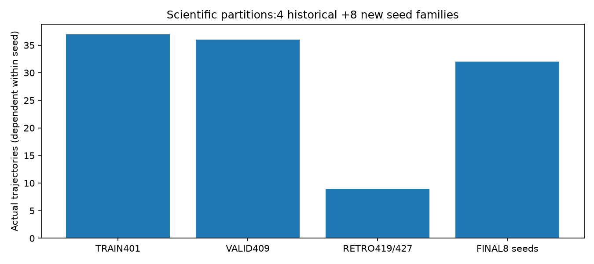
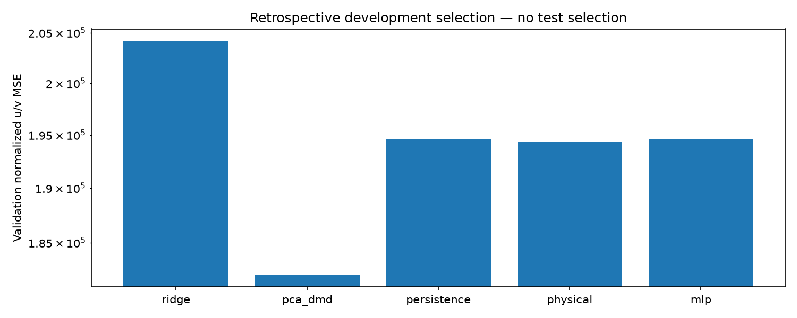
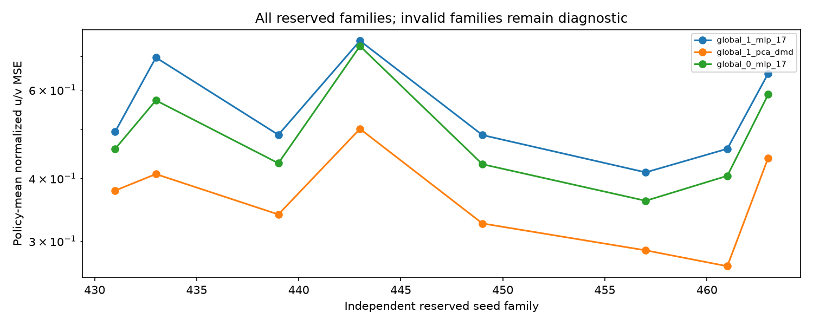
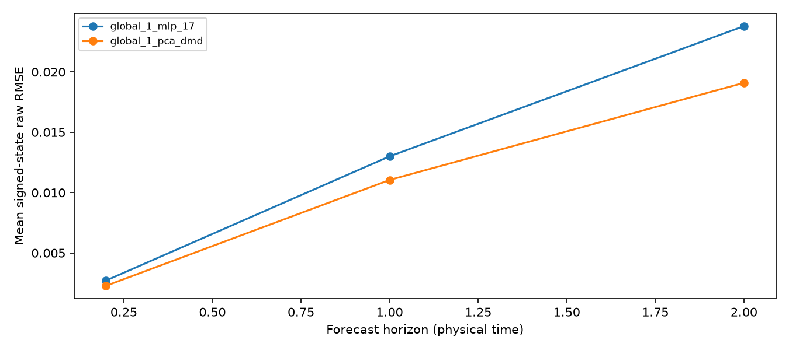
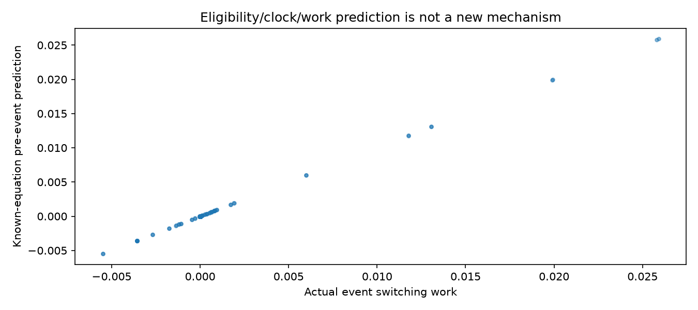
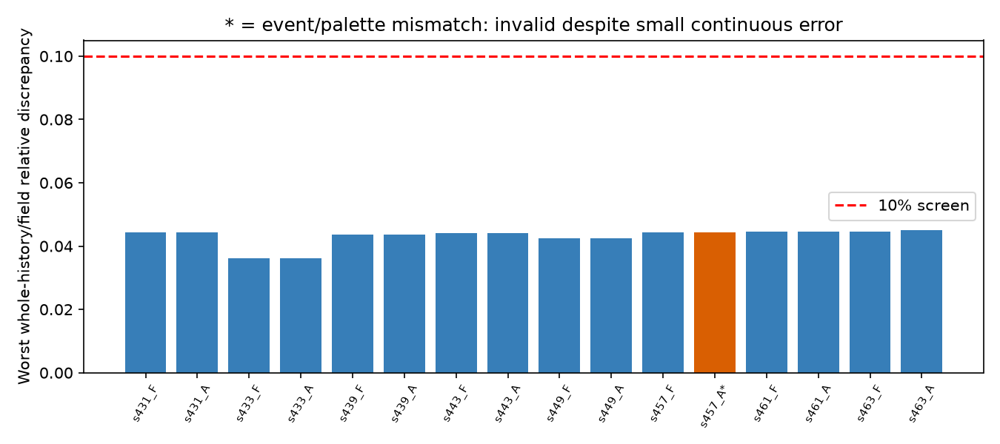
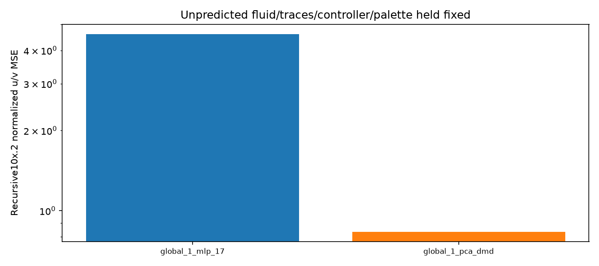
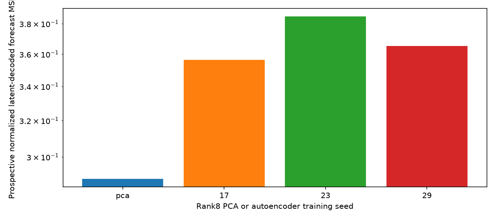
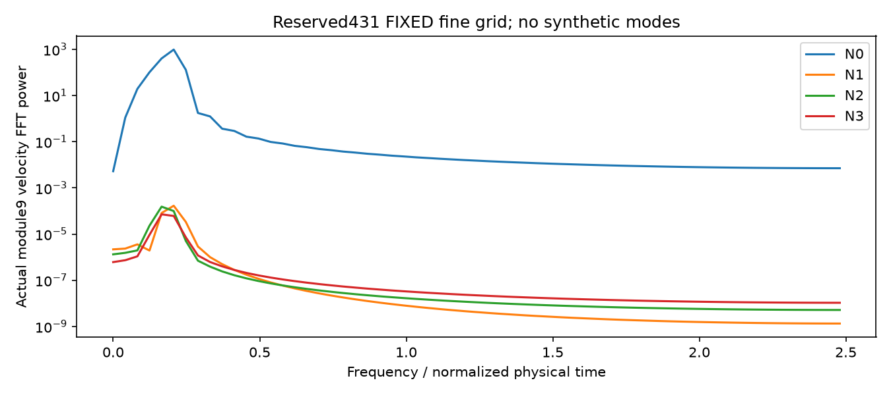

# Experiment0013: the external learner — measured results

Registration `c018c65` precedes extraction, fitting and all new outcomes. Instrument
implementation `4a69acb`; held-family evaluation/proposal `08a203d`. Rust remains
physical authority. PyTorch observes and predicts; it never controls the substrate.
Principle002 remains proposed. No overall success score or QR learning/memory claim.

| Separate scientific question | Verdict |
|---|---|
| G1: Dataset integrity | PASS |
| G2: Predictive utility | FAIL |
| G3: Morphology information | FAIL |
| G4: Latent structure | FAIL |
| G5: Prospective discovery | NOT RUN |
| G6: Research efficiency | NOT RUN |

On 7 valid prospective families, the selected MLP has51.3% higher u/v MSE than the selected linear baseline. Explicit palette input has8.0% higher event-window loss. The autoencoder's reconstruction/latent forecast losses are30.8%/23.4% higher than PCA. These are results for this registered instrument/data budget, not a general rejection of machine learning or QR physics.

## Evidence, dependency and actual execution

Both original QR12 archive hashes pass. All82 historical executions are inventoried,
including2 protocol-invalid intended controls and separate corrective diagnostics.
Historical phases are retrospective. All descendants/refinements/repeats stay in
their physical seed family:401 train,409 validation,419/427 retrospective test.
Thousands of windows/nodes are not independent replications. Duplicates, scalar/
private/oracle cases and numerical invalidity remain explicit in the inventory.
Dataset/metric audits compare compact arrays against actual raw streams, check
horizon alignment, metadata/units, ancestry, invalid labels and family separation.

All32 reserved Rust trajectories actually executed:8 independent new seed families,
FIXED/ADAPTIVE on P/F, unchanged QR12 physics/pulse/SQ, horizon24. Actual case wall
343.140542s; raw case bytes3543621599; peak child RSS
65644KiB. No GPU physics or new physical law. Model/split/
candidate/normalization/checkpoint hashes were sealed BEFORE new execution.
Numerically valid BOTH-policy families:[431, 433, 439, 443, 449, 461, 463]. Invalid families:[457].
All predictions remain saved; only registered valid family pairs decide gates.
Full state/event agreement, not pretty aggregate plots, determines validity.

## Baselines and external predictive instrument

Persistence, three-lag ridge AR, rank-truncated PCA/linear delay dynamics and a
known-equation frozen-pressure oscillator reduction precede neural fitting. The
PCA delay model is a regularized reduced-rank observable map (DMD-style); its
compact observations are not assumed closed. A separate rank8 PCA latent model
fits ordinary affine8-to8 dynamics. Neither is a separate discovery.
Ordinary spectra/correlations/Hilbert phases retain undefined-pair counts. Rank8
PCA explains96.115% of TRAIN normalized-state variance, not held-out variance. Exact
full-fluid QR12 composition remains a known accurate unreduced reference.

Selected primary:`global_1_mlp_17`; ordinary comparator:`global_1_pca_dmd`.
Validation normalized u/v losses:194629.844 versus
182066.432. No replacement by best-test model occurred.
All24 forecast fits (MLP/GRU, local/global, palette/state-only,3 training seeds),
three autoencoders and one exact training replay are retained. Total recorded
training time76.198628s; largest forecast model
159064parameters. CPU float32 learner, float64
physics/audit; pinned PyTorch2.15.0+cpu. No CUDA run or GPU compatibility benchmark.
One cost-only benchmark extension stopped on a missing-variable NameError; its
log is retained as cost-benchmark-failed.log. The instrumentation was corrected
before expanded timings; models, physical data, predictions and gates were unchanged.
Inference costs are recorded in inference-costs.json: end-to-end CPU prediction
includes normalization/model loading. The baseline uses a dense exported matrix,
not optimized low-rank factors; these timings establish no algorithmic speed
superiority or hypothesis-selection efficiency.
Same-CPU/software repeat parameter tensors and validation predictions agree exactly;
that does not promise cross-platform/version bitwise agreement.

Local features use only own state/history/palette; global features include all
four bodies, current/past global accounts and apparatus forcing kind. Global
accuracy is an external instrument capability, never a neuron's capability.
Forecasts use t-.4,t-.2,t; horizons.2,1,2. Morphology ablation omits explicit
palette, but state/energy/history may already carry structural information.
Input/target normalization/PCA fit only TRAIN401. Validation includes forcing/
geometry regimes absent in training; these are distribution shifts, not evidence
of a new law. Poor external forecasts do not invalidate the physical simulation.






## G2 forecast and G3 morphology information

Primary mean loss equally averages both policies, nodes and three horizons.
Uncertainty uses independent seed families: exact paired sign-flip p and10000
family bootstrap resamples; no timestamp sample-size inflation. Registered10%
improvement, p<=.05, positive bootstrap lower bound, fine-grid direction and both
training-seed replications are separate requirements. Complete arrays, per-node
signed errors, energy/pressure targets, ordinary/event/accepted-event strata,
recursive10-step error and every failed prediction remain in the evidence.
All 32 primary cases have finite predictions; 2986of41856predicted energies are negative. These are external prediction defects, never changes to physical state.

```json
{
  "G2": {
    "primary": {
      "families": 7,
      "reference": [
        0.37800128326277554,
        0.40771455499162124,
        0.33884561637907396,
        0.5016131367614782,
        0.32512327075167896,
        0.26728481559099015,
        0.43895382000227523
      ],
      "learned": [
        0.4947799644781383,
        0.6957014651677088,
        0.4881417370043861,
        0.7511278863540269,
        0.48755605389031254,
        0.45784676095629356,
        0.6464499844696965
      ],
      "relative_improvement": -0.5132826419282456,
      "p_one_sided": 1.0,
      "bootstrap95": [
        -0.6106346301113974,
        -0.4245906713315329
      ]
    },
    "fine": {
      "families": 7,
      "reference": [
        0.38441116818916143,
        0.42200328985596725,
        0.35082102739535914,
        0.5160179333077519,
        0.3317087220888959,
        0.27302175864651346,
        0.4485602975488888
      ],
      "learned": [
        0.5020833362809618,
        0.7155646978422574,
        0.5026423312924618,
        0.7700997035932837,
        0.4962994367712328,
        0.4639600632453865,
        0.6561735462921195
      ],
      "relative_improvement": -0.5062375001246656,
      "p_one_sided": 1.0,
      "bootstrap95": [
        -0.6018294760627304,
        -0.4190227453119876
      ]
    },
    "replication": [
      {
        "training_seed": 23,
        "primary": -0.4883307429370656,
        "fine": -0.48070972940524564
      },
      {
        "training_seed": 29,
        "primary": -0.4937077992555257,
        "fine": -0.4860173855433539
      }
    ]
  },
  "G3": {
    "primary": {
      "families": 7,
      "reference": [
        0.9884813903796232,
        1.0842529910239302,
        0.8216884786622253,
        1.3981409945746077,
        0.8501284181176642,
        0.670911925573951,
        1.0756984103803369
      ],
      "learned": [
        0.9759181692649319,
        1.329808272979725,
        0.9057745524232859,
        1.394442981329147,
        0.891866972588558,
        0.7997982398478853,
        1.1411710770881551
      ],
      "relative_improvement": -0.07975809570543041,
      "p_one_sided": 0.9765625,
      "bootstrap95": [
        -0.15065900379024552,
        -0.0234642457857454
      ]
    },
    "fine": {
      "families": 7,
      "reference": [
        1.0019117393905772,
        1.1219919788009487,
        0.8496839029896324,
        1.4310686927426484,
        0.8668884085386543,
        0.6823849474283197,
        1.0968900249209805
      ],
      "learned": [
        0.9871789697522168,
        1.3659155572828816,
        0.9311202462942221,
        1.4264340024894713,
        0.9058801796351958,
        0.8099396550535306,
        1.1554097870835391
      ],
      "relative_improvement": -0.07531871835696839,
      "p_one_sided": 0.9765625,
      "bootstrap95": [
        -0.14445326768975617,
        -0.02019627868531163
      ]
    },
    "replication": [
      {
        "training_seed": 23,
        "primary": -0.07837430143169538,
        "fine": -0.07331260428169167
      },
      {
        "training_seed": 29,
        "primary": -0.0871929692016012,
        "fine": -0.08289620497906029
      }
    ]
  }
}
```

Eligibility, occurrence and switching work are separately explained by the
known deterministic local law, apparatus permission and Epost-Epre at unchanged
u/v. Work prediction maximum absolute error:2.22044605e-16.
No additional scalar neural classifier was registered/trained. Those predictable
labels do not establish learned causal insight. Actual local/remote consequences
are evaluated separately by the palette forecast ablation. The prospective
FIXED/ADAPTIVE comparison changes all eligible nodes; it is not an isolated N0
event intervention. Historical QR12 exact single-event remote size FAIL remains
unchanged. Equal total switch/sham energy never implies identical modal state.





Actual primary-grid per-node signed-state forecast errors on valid families
(equal case/coordinate averaging; descriptive, not extra independent samples):

| Model | Horizon | N0 u/v RMSE | N1 u/v RMSE | N2 u/v RMSE | N3 u/v RMSE |
|---|---|---|---|---|---|
| MLP | 0.2 | 0.01134043 | 5.402096e-06 | 5.905608e-06 | 4.172664e-06 |
| MLP | 1.0 | 0.05464067 | 2.67709e-05 | 2.708262e-05 | 1.749772e-05 |
| MLP | 2.0 | 0.1019459 | 4.830347e-05 | 4.84253e-05 | 2.948801e-05 |
| Linear | 0.2 | 0.009391529 | 4.25648e-06 | 4.71203e-06 | 3.048718e-06 |
| Linear | 1.0 | 0.04533685 | 2.092358e-05 | 2.292623e-05 | 1.54361e-05 |
| Linear | 2.0 | 0.07873349 | 3.644773e-05 | 3.937474e-05 | 2.744661e-05 |


N0 is externally driven; N1/N2/N3 are externally unforced. These errors are not
single-event causal effect sizes. The final24-unit event changes palette/energy
but has no subsequent u/v evolution in this window; u/v event-consequence evidence
therefore comes from the16-unit event and intervals after it. The horizon choice
cannot establish the consequences of the final switch. This limitation does not
change the preregistered event-window gate.

## G4 latent structure and observability

Rank8 PCA and autoencoders compare reconstruction, decoded forecast, neural-energy
preservation, event crossings and both grids on the same families. Independent
training-seed latent coordinates are aligned using TRAIN-only affine maps; aligned
errors remain reported rather than interpreted as meaningful modes. Two-step
latent closure is an approximate reduced-model diagnostic, not a functor theorem
or categorical engineering advantage. No latent cluster is called emergence. Latent-coordinate closure errors depend
on the encoder coordinate gauge; decoded physical forecast/reconstruction losses
are the meaningful cross-representation comparisons.

```json
{
  "G4": "FAIL",
  "comparisons": {
    "reconstruction": {
      "primary": {
        "families": 7,
        "reference": [
          0.21407483471597474,
          0.2609265062570249,
          0.17217694861565783,
          0.29236650550211457,
          0.19191050220385053,
          0.1400248200576974,
          0.19610606126770685
        ],
        "learned": [
          0.2632356033003357,
          0.3447353165279839,
          0.22148316146262928,
          0.3594183029532193,
          0.2932893877585784,
          0.19088093610927748,
          0.24722395175312936
        ],
        "relative_improvement": -0.30845240152832654,
        "p_one_sided": 1.0,
        "bootstrap95": [
          -0.39033430321314916,
          -0.25133897223952884
        ]
      },
      "fine": {
        "families": 7,
        "reference": [
          0.21665457275612426,
          0.2686854762039626,
          0.17791235966835828,
          0.2989111491590587,
          0.1948675153963541,
          0.14290967384965758,
          0.20007174398734373
        ],
        "learned": [
          0.26634749583173034,
          0.35325253307618004,
          0.22657558497822283,
          0.3673340094862199,
          0.29706426650802453,
          0.19460244777743935,
          0.25171387247720595
        ],
        "relative_improvement": -0.3045826097109549,
        "p_one_sided": 1.0,
        "bootstrap95": [
          -0.38514819671750666,
          -0.24901435746742323
        ]
      },
      "replicate_improvements": [
        -1.178188329272021,
        -1.1537425661617988,
        -0.44078336140760827,
        -0.4324322843459634
      ]
    },
    "forecast": {
      "primary": {
        "families": 7,
        "reference": [
          0.2838145911699218,
          0.3620138444154779,
          0.25809128632797007,
          0.41468368204294836,
          0.26790213370373006,
          0.2020781507888291,
          0.29643399677908444
        ],
        "learned": [
          0.34684360608138853,
          0.4593799058895427,
          0.3105498696377295,
          0.48974647260933135,
          0.3871920245583147,
          0.23685499161483248,
          0.3430017893894194
        ],
        "relative_improvement": -0.2343150266848607,
        "p_one_sided": 1.0,
        "bootstrap95": [
          -0.3090783668744295,
          -0.18104605532247
        ]
      },
      "fine": {
        "families": 7,
        "reference": [
          0.2878761782058134,
          0.3736105176238983,
          0.26728630694286226,
          0.42467025861738883,
          0.2725265860056897,
          0.20651269244222054,
          0.3027579656879281
        ],
        "learned": [
          0.3515823242853837,
          0.47228669335949225,
          0.31916715464615397,
          0.5013599738826453,
          0.3931354080980939,
          0.24231128124863832,
          0.3499124177111649
        ],
        "relative_improvement": -0.23159674351718873,
        "p_one_sided": 1.0,
        "bootstrap95": [
          -0.3058616092017988,
          -0.17923710974446044
        ]
      },
      "replicate_improvements": [
        -0.3486881129268968,
        -0.3433459747086434,
        -0.2699290393050181,
        -0.2658359415252466
      ]
    }
  }
}
```




## Post-outcome observation-interface diagnostic

This retrospective diagnostic was added AFTER final evaluation, not selected from
historical development and not a G5 discovery. The registered observer omits the
external FIXED/ADAPTIVE permission policy. Before the first switch, each paired
run has identical supplied features/palette but13 horizon labels later differ
in u/v. The simulator remains deterministic given complete state AND control.
Metadata retains the policy, so dataset origin/integrity is not ambiguous.

For identical inputs with equally weighted targets a,b, the best squared-loss
prediction is(a+b)/2 and irreducible policy-average error is(a-b)^2/4. The measured
valid-family normalized u/v floor is2.07634333e-05,
only0.005469% of the selected
baseline's error. This omission is real but much too small to explain the51.3%
neural performance gap. No inputs, models, normalizers or gates were repaired.
Full paired counts/times/grids remain in post-outcome-observation-collisions.csv.

Distinct physical arrows/commands should remain distinguishable in a future
control-conditioned global observer. This is an ordinary state-space modeling
requirement; it confers no categorical engineering premium. The independent
proposal separates this diagnostic from the original hidden-fluid closure idea.

## G5 discovery and G6 research efficiency

No candidate met the historical nomination requirements. All3 rejected candidates
and reasons were frozen before final physics. No extra discovery intervention
or independent experiment-selection decision study was executed: G5/G6 NOT RUN.
Inference speed/forecast accuracy is not improved hypothesis selection. There is
no learner-generated new physical mechanism claim. The separate independent
[Codex proposal](EXPERIMENT_0013_CODEX_INDEPENDENT_PROPOSAL.md) argues for an
observability/closure experiment0014, with explicit equal-energy hidden-fluid
controls. Its algebraic rank observation and future hypothesis do not rescue0013
gates or count as prospective discovery. QR12's categorical engineering FAIL remains.

## Limits and next bounded question

Only one historical training seed and one validation seed support instrument
selection, despite many dependent cases. The compact observer omits most fluid
state, and its future is not generally a closed deterministic transition. Shared
kernel two-port sampling, restricted forcing and prescribed event clocks can
produce low-dimensional observations without a novel physical mode. Recursive
forecasts hold unpredicted fluid/trace/controller/palette state fixed; accumulation
and event errors expose that closure assumption. No fitted observer modifies QR
physics; no4096-body, real-material, useful-memory or commercial-performance claim.

Next research requires a new registration: independently excited development
families, explicit missing-fluid-state diagnostics and stronger closure/error
models before larger learners. Preserve all failed forecasts, invalid cases,
rejected hypotheses and historical scientific failures.

## Reproducibility and delivery

Quick Review contains source/docs/figures, complete compact observations, models,
selection/metrics/candidates. Full Evidence adds all new raw fields/streams,
full predictions and the unchanged original QR12 archives as nested ancestry.
Extract BOTH into one directory; `analysis.validate_0013` selectively restores
historical raw paths without overwriting current source, checks member/source/raw
hashes, audits all114 dataset origins and new physical/numerical records, and
re-evaluates sealed models without fitting on tests. See PORTABLE_README.md.
Local strict checks, archive/fresh rebuild/replay, pushed SHA and hosted CI have
separate ignored receipts. Missing receipts remain pending, never scientific PASS.
